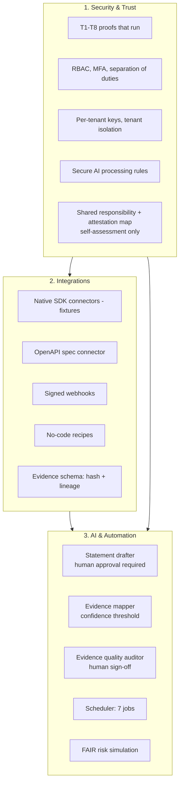
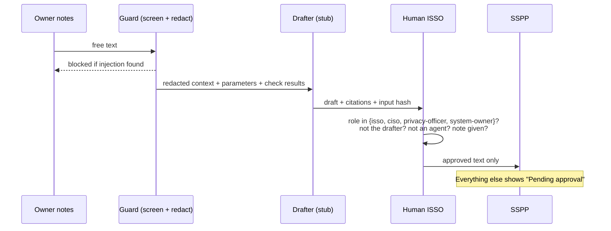

# Agentic AI plan

Plain-English plan for where AI helps in this repo, where it must not decide, and how the three
platform areas fit together. Everything described as **built** runs offline today with a deterministic
stub. Anything that would call a hosted model is **planned** and would use Microsoft Foundry.

## The three platform areas



| Area | Built | Planned |
|---|---|---|
| Security & Trust | `arcampe/platform/*`, proofs T1-T8, docs/SECURITY_AND_TRUST.md | Real key vault, real identity provider |
| Integrations | 24 fixture connectors, OpenAPI, webhooks, no-code recipes, mapper | Live read-only connectors |
| AI & Automation | Drafter stub, mapper, auditor, scheduler, risk | Microsoft Foundry backend over a private endpoint |

## Agents and what they may do

| Agent | Reads | Writes | May NOT |
|---|---|---|---|
| Statement drafter (`arcampe/agent.py`) | Catalog text, parameters, check results, redacted notes | A draft with citations | Approve, publish, call the network |
| Evidence mapper (`integrations/mapper.py`) | One evidence record | A suggested control + confidence | Auto-map below 0.6 (goes to a human queue) |
| Evidence auditor (`automation/ai_auditor.py`) | Evidence records | A quality score and recommendation | Sign off; a human with MFA must |
| Scheduler (`automation/scheduler.py`) | Connectors, POA&M | Refresh logs, draft alerts | Send email; alerts are drafts |

## Approval flow



## Safety rules (tested)

- Agents hold only `read` and `draft_statement` permissions, whatever role they are given.
- An agent or the drafter can never approve. An empty reviewer note is refused.
- Prompt-injection phrases block the draft; SSNs, phone numbers, emails and Medicaid IDs are redacted first.
- Egress is allow-listed to the Microsoft Foundry private endpoint names; public IPs and other hosts are refused.
- AI config must keep customer data out of training, retention at 0 days, US regions, private endpoint, no local auth.
  Zero retention is a **config claim** and needs Microsoft approval for abuse-monitoring opt-out in real life.

## Measured today

<!-- run: python -m arcampe mapper -->
```text
{
 "items": 60,
 "threshold": 0.6,
 "auto": 58,
 "review": 2,
 "precision": 0.983,
 "recall": 0.95,
 "review_queue_caught_errors": 0
}
```
<!-- /run -->

## Next steps (planned, not built)

1. Add a Microsoft Foundry backend behind the same `complete(ctx)` interface; keep the stub for CI.
2. Add an eval set of human-written statements and score drafts against it before enabling the backend.
3. Log every draft and approval to the hash-chained audit log.
