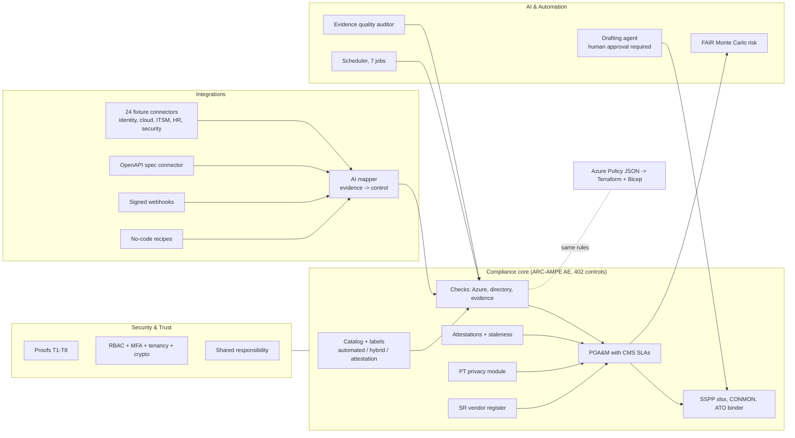
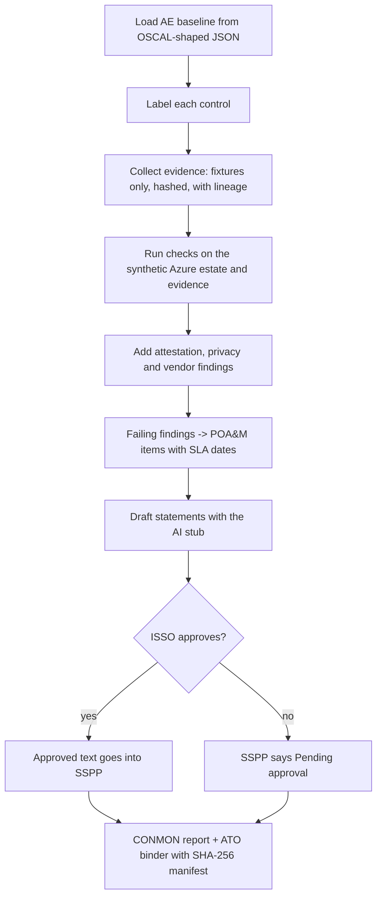

# Jagadish-arc-ampe-compliance-automation

**Compliance automation for an ACA Administering Entity under CMS ARC-AMPE: 402 controls, each labelled
automated, hybrid or attestation, with checks, a POA&M, an SSPP workbook, a CONMON report and an ATO binder.**

> **Recruiter summary.** State health exchanges and their vendors must meet ARC-AMPE (CMS's NIST
> SP 800-53 Rev 5 based baseline) and rebuild the same evidence by hand every year. This repo turns
> the 402-control AE baseline into code: 65 controls are checked by machine, 207 need a machine check
> plus a human, and 130 need a signed attestation that goes stale on a clock. Failing checks become
> POA&M items with CMS SLA dates; an AI drafter writes control statements that only a human ISSO can
> approve. Proof below is printed by real runs: the test count, 531 findings on a synthetic Azure
> estate, 5 planted misconfigurations caught, Azure Policy and Python checks agreeing on 6 of 6, and
> a byte-for-byte reproducible ATO binder.

**Everything is synthetic.** The entity (Lakehaven Health Connector, `lakehaven-hx.example`), its
people, vendors and Azure estate are fictional. Nothing is deployed, billed or connected to a real API.
Nothing here is a CMS ATO, a FedRAMP authorization, a SOC 2 report or any other certification; the trust
material is a **self-assessment design**.

<!-- run: python scripts/count_tests.py -->
```text
2175 tests collected
```
<!-- /run -->

## Start here: reading order

New here? Start with the numbered learning sequence at [docs/learn/00_START_HERE.md](docs/learn/00_START_HERE.md).
Read top to bottom; each line says what the file explains. Every number in these files is printed by a
real run and re-checked in CI.

| # | File | What it explains |
|---:|---|---|
| 1 | [README.md](README.md) | This page: summary, architecture, measured results, how to run |
| 2 | [docs/purpose.md](docs/purpose.md) | The problem, who it is for, and what the three labels mean |
| 3 | [docs/AUDIT_AUTOMATION_EXPLAINED.md](docs/AUDIT_AUTOMATION_EXPLAINED.md) | **How checklist and audit automation works end to end**, walking control IA-02 (MFA) through every step with real output |
| 4 | [docs/USE_CASES.md](docs/USE_CASES.md) | **Seventeen end-to-end use cases** (first ATO, public storage to closure, yearly renewal, new vendor, privacy incident, regulatory change, auditor with AI copilot, leadership report, BU readiness, control drift, PR gate, AI accountability, identity recovery, multi-org industry packs, scanner evidence) with real commands and output |
| 5 | [docs/glossary.md](docs/glossary.md) | Every acronym (ATO, SSPP, POA&M, CONMON, FAIR ...) in one line |
| 6 | [docs/architecture.md](docs/architecture.md) | Modules, data flow and where each piece of logic lives |
| 7 | [docs/how-it-works.md](docs/how-it-works.md) | The pipeline step by step with real command output |
| 8 | [docs/how-to-run.md](docs/how-to-run.md) | Commands to install, test and run offline |
| 9 | [docs/control-catalog.md](docs/control-catalog.md) | Where the 402 controls come from and how labels are decided |
| 10 | [docs/crosswalks.md](docs/crosswalks.md) | One control mapped to HIPAA, SOC 2, ISO 27001, PCI DSS, GDPR, CCPA, COBIT, FedRAMP proxy |
| 11 | [docs/INTEGRATIONS.md](docs/INTEGRATIONS.md) | Connectors, evidence record and hashing, webhooks, AI mapper |
| 12 | [AGENTIC_AI_PLAN.md](AGENTIC_AI_PLAN.md) | Where AI helps, where it must not decide, and the human approval flow |
| 13 | [docs/SECURITY_AND_TRUST.md](docs/SECURITY_AND_TRUST.md) | Eight security claims proven by code, shared responsibility, AI safety rules |
| 14 | [docs/risk-faq.md](docs/risk-faq.md) | Cyber risk in dollars, the top 10, and six common risk questions answered |
| 15 | [docs/guardrails.md](docs/guardrails.md) | Every safety rule, the file that enforces it and its test |
| 16 | [docs/threat-model.md](docs/threat-model.md) | STRIDE and OWASP LLM threats and their controls |
| 17 | [docs/limitations.md](docs/limitations.md) | What is synthetic, simplified or unproven |
| 18 | [docs/SOURCE_COVERAGE.md](docs/SOURCE_COVERAGE.md) | Capability areas of a commercial GRC product vs this repo |
| 19 | [docs/implementation-guide.md](docs/implementation-guide.md) | Steps to adapt it to a real organisation |
| 20 | [docs/interview-points.md](docs/interview-points.md) | Short answers for reviewers and interviews |
| 21 | [docs/adr/0001-three-labels.md](docs/adr/0001-three-labels.md) | Decision: three labels, with "automated" computed from tests |
| 22 | [docs/adr/0002-policy-json-single-source.md](docs/adr/0002-policy-json-single-source.md) | Decision: one policy JSON feeds Terraform, Bicep and the parity test |
| 23 | [docs/adr/0003-human-approval-for-ai.md](docs/adr/0003-human-approval-for-ai.md) | Decision: AI only drafts; a human approves |
| 24 | [docs/adr/0004-deterministic-outputs.md](docs/adr/0004-deterministic-outputs.md) | Decision: every output is reproducible byte for byte |
| 25 | [docs/trust-pack/whitepaper_template.md](docs/trust-pack/whitepaper_template.md) | Template: security whitepaper for customers |
| 26 | [docs/trust-pack/architecture_overview_template.md](docs/trust-pack/architecture_overview_template.md) | Template: architecture overview for customers |
| 27 | [docs/trust-pack/request_checklist.md](docs/trust-pack/request_checklist.md) | Checklist of documents a customer security team usually asks for |
| 28 | [SECURITY.md](SECURITY.md) | How to report a vulnerability in this repo |
| 29 | [docs/learn/00_START_HERE.md](docs/learn/00_START_HERE.md) | Learning sequence start: what to read, in order |
| 30 | [docs/learn/01_THE_PROBLEM.md](docs/learn/01_THE_PROBLEM.md) | Why the yearly compliance cycle is slow |
| 31 | [docs/learn/02_CONCEPTS.md](docs/learn/02_CONCEPTS.md) | Control, evidence, POA&M, readiness, autonomy level |
| 32 | [docs/learn/03_ARCHITECTURE.md](docs/learn/03_ARCHITECTURE.md) | Core plus the GRC extension, with a diagram |
| 33 | [docs/learn/04_AGENTS.md](docs/learn/04_AGENTS.md) | Every agent, its autonomy level and approver; MCP-style server |
| 34 | [docs/learn/05_WORKFLOWS.md](docs/learn/05_WORKFLOWS.md) | Workflows, expert review, pipeline gate, freshness, owners, scanner import |
| 35 | [docs/learn/06_FRAMEWORKS_AND_READINESS.md](docs/learn/06_FRAMEWORKS_AND_READINESS.md) | 34 frameworks, readiness rings, industry packs and multi-org mode |
| 36 | [docs/learn/07_AI_GOVERNANCE.md](docs/learn/07_AI_GOVERNANCE.md) | Model register, shadow AI, decision rights, decision records, replay, 12 KPIs |
| 37 | [docs/learn/08_IDENTITY_RESILIENCE.md](docs/learn/08_IDENTITY_RESILIENCE.md) | Identity as the first recovery dependency (CP-4, CP-9, CP-10) |
| 38 | [docs/learn/09_EXECUTIVE_REPORTING.md](docs/learn/09_EXECUTIVE_REPORTING.md) | Daily and weekly leadership reports, previews only |
| 39 | [docs/learn/10_USE_CASES.md](docs/learn/10_USE_CASES.md) | The seventeen stories |
| 40 | [docs/learn/11_HOW_TO_RUN.md](docs/learn/11_HOW_TO_RUN.md) | Commands |
| 41 | [docs/learn/12_RESULTS.md](docs/learn/12_RESULTS.md) | Measured numbers |
| 42 | [docs/learn/13_LIMITATIONS.md](docs/learn/13_LIMITATIONS.md) | What this is not |
| 43 | [docs/learn/14_GRC_OPERATIONS.md](docs/learn/14_GRC_OPERATIONS.md) | Readiness sign-off, recipes, insights, scorecards, AI tests, audit hub, EU CRA clocks |
| 44 | [PRESENTATION_GUIDE.md](PRESENTATION_GUIDE.md) | 5- and 15-minute scripts, demo commands, interview Q&A, cheat card |
| 45 | [examples/reporting/DEPLOY.md](examples/reporting/DEPLOY.md) | Scheduling and (approval-gated) sending: cron, GitHub Actions, Microsoft Foundry, Logic Apps, SendGrid |
| 46 | [USE_CASES.md](USE_CASES.md) | One-page summary: who the repo is for, what to try offline, and when not to use it |

## GRC extension (`arcampe/grc/`)

Added on top of the core, offline and synthetic. Each item has tests and a CLI command
(`python -m arcampe.grc <command> --out out`).

| Area | What it does | Command |
|---|---|---|
| BU workspaces | Readiness, owners and exceptions per business unit | `workspaces` |
| Workflow builder | Event to action rules; actions are logged, never sent | `workflows` |
| Custom tests, risk registers | Your own checks; registers with formulas, library and snapshots | `custom-tests`, `risk` |
| Frameworks | 34-framework registry, readiness rings | `frameworks` |
| Industry packs, multi-org | FFIEC/ACET, CMMC L2, ABA 1.6, SEC Reg S-P (approximate); org-scoped keys | `industry-packs` |
| Auditor area | Audit-mode freeze, sampling, SHA-256 manifest package | `audit-package` |
| Expert review | Owner submits, expert approves; edits after approval return to review | `review` |
| Compliance as code | Fix suggestions and a PR gate on new high findings | `cac` |
| MCP-style server | Read tools; write tools only create pending changes for human approval | `mcp` |
| AI policy and governance | AI-DEV-EVAL control, model and app register, shadow AI, decision rights, decision records, replay, 12 KPIs | `ai-policy`, `ai-governance` |
| SOC 2 path, evidence status, owners | "N of 36 checked", freshness, escalation ladder | `soc2`, `evidence`, `owners` |
| Vendors, access reviews | Request and questionnaire workflow; access-review import | `vendors`, `access-review` |
| Scanner evidence | Nessus-style CSV/XML to RA-5 and SI-2 evidence | `scanner` |
| Identity resilience | Identity backup and drill evidence (CP-4, CP-9, CP-10) | `identity` |
| Leadership reports | Daily and weekly HTML, PDF, CSV and .eml **previews**; sending needs config + approval + transport | `report`, `schedule` |
| Trust dashboard | Static HTML with readiness rings | `dashboard` |
| Control readiness approval | Evidence + tests + policy + approved statement, then a named sign-off bound to evidence hashes | `readiness-approval` |
| Workflow recipes, digest, recurring reviews | 10 one-trigger recipes (simulated actions), Monday digest file, cadence engine | `recipes`, `recurring` |
| Insights and risk program | Pass-to-fail flips and MTTR; register moves; FAIR-style P50/P90/P95 loss ranges; risk SLAs | `insights`, `risk-program` |
| Policy approval tiers | 1 to 6 tiers (all / any / k-of-n) and a labeled change summary | `policy-approvals` |
| AI-drafted tests and mapping eval | Validator with 3 retries, dedupe, human review; exact/paraphrase/partial/keyword eval with MRR | `ai-tests`, `mapping-eval` |
| Audit hub, AI frameworks, roadmap | Auditor requests to controls, hash-chained evidence, AIUC-1 domains, EU CRA clocks, "which framework next" | `audit-hub`, `ai-frameworks`, `roadmap` |
| Leadership scorecards | Efficiency, Risk (with loss ranges), Trust; every row labeled measured or SIMULATED | `scorecards` |

<!-- run: python -m arcampe.grc ai-governance --out out -->
```text
Agent decision explainability rate: 96.7% [measured, synthetic]
Decision-audit pass rate: 96.0% (24/25 replayed) [measured, synthetic]
Agent monitoring coverage: 83.3% (5/6) [measured, synthetic]
Human-approval SLA and override rate: median 9.0h; 11.7% edited [measured, synthetic]
Autonomy level mix: suggest_only 5, act_with_approval 1, act_then_notify 0 [configuration]
AI decision-rights coverage: 80.0% [configuration]
Shadow AI exposure: 4 unapproved tools; 25.0% triaged within SLA [measured, synthetic]
AI vendor concentration index: top-1 60.0%, top-2 80.0%, fallback 60.0% [measured, synthetic]
AI regulatory readiness (approximate): ISO/IEC 42001 27.6%; NIST AI RMF 1.0 29.2%; EU AI Act 23.0% [measured, synthetic]
Agent legal-risk incidents blocked: 6 blocked (critical 3, high 2, moderate 1) [measured, scripted attempts]
AI program ROI: 5.8 analyst hours saved; $493 at $85/h; $0.04/run [SIMULATED]
AI provider outage drill: 2026-08-20: partial (Provider A unavailable for 8 hours) [synthetic]
register: {"entries": 5, "by_status": {"approved": 3, "conditional": 1, "retired": 1}, "uses": 7, "uses_compliant": 3, "inventory_coverage_pct": 83.3}
```
<!-- /run -->

## Purpose and who it is for

| Reader | What they get |
|---|---|
| ISSO / compliance lead at a state exchange or Medicaid E&E vendor | A control-by-control plan of what can be automated and what must stay a signature |
| Cloud / platform engineer | Python checks plus the same rules as Azure Policy in Terraform and Bicep |
| Assessor | A binder with a SHA-256 manifest, evidence lineage and a POA&M that is rebuilt from findings |
| Recruiter / hiring manager | Evidence of GRC engineering, Azure, IaC, test discipline and safe AI use |

## Architecture

Three platform areas sit around the compliance core.



## How it works, step by step



1. **Catalog.** `arcampe/catalog.py` loads the 402-control AE baseline. Each control gets one label.
2. **Evidence.** Connectors read JSON fixtures, hash each record and record where it came from.
3. **Checks.** 30 Azure checks, 13 identity/evidence checks, attestation clocks, privacy and vendor checks.
4. **POA&M.** Every failing finding becomes an item with a due date from CMS SLA days (15/30/90/365).
5. **Statements.** An AI drafter (deterministic stub offline) writes a draft; only a human ISSO can approve.
6. **Outputs.** SSPP workbook, CONMON Markdown/HTML and a zip binder whose manifest can be re-verified.

## Control counts by family and label (real run)

<!-- run: python -m arcampe catalog -->
```text
| Family | Name | Controls | Automated | Hybrid | Attestation |
|---|---|---:|---:|---:|---:|
| AC | Access Control | 51 | 14 | 36 | 1 |
| AT | Awareness and Training | 9 | 0 | 2 | 7 |
| AU | Audit and Accountability | 19 | 9 | 9 | 1 |
| CA | Assessment, Authorization, and Monitoring | 12 | 1 | 7 | 4 |
| CM | Configuration Management | 31 | 6 | 24 | 1 |
| CP | Contingency Planning | 23 | 3 | 12 | 8 |
| IA | Identification and Authentication | 24 | 6 | 17 | 1 |
| IR | Incident Response | 16 | 1 | 8 | 7 |
| MA | Maintenance | 16 | 0 | 2 | 14 |
| MP | Media Protection | 9 | 0 | 1 | 8 |
| PE | Physical and Environmental Protection | 19 | 0 | 0 | 19 |
| PL | Planning | 6 | 0 | 1 | 5 |
| PM | Program Management | 28 | 0 | 2 | 26 |
| PS | Personnel Security | 9 | 1 | 1 | 7 |
| PT | Personally Identifiable Information Processing and Transparency | 10 | 0 | 7 | 3 |
| RA | Risk Assessment | 12 | 2 | 8 | 2 |
| SA | System and Services Acquisition | 34 | 2 | 21 | 11 |
| SC | System and Communications Protection | 34 | 13 | 20 | 1 |
| SI | System and Information Integrity | 34 | 6 | 27 | 1 |
| SR | Supply Chain Risk Management | 6 | 1 | 2 | 3 |
| **All** | 20 families | **402** | **65** | **207** | **130** |
```
<!-- /run -->

Labels: **automated** = a machine check decides; **hybrid** = a machine check plus a human step;
**attestation** = a named owner signs on a schedule. "Automated" is computed from the check registries, so a
control is only called automated if tested code checks it. The hybrid/attestation split is a rule set in
`arcampe/labels.py` (the author's judgement, not a CMS designation).

## Measured results (synthetic estate, real runs)

<!-- run: python -m arcampe trust -->
```text
T1 PASS Secure by design
T2 PASS Continuous monitoring (threat detection, vulnerability scanning)
T3 PASS Data protection (encryption in transit and at rest, strict access)
T4 PASS Compliance aligned (NIST 800-53, FedRAMP-style baseline)
T5 PASS Isolated multi-tenant cloud
T6 PASS Least privilege (RBAC plus MFA)
T7 PASS Audited and tested (pen test and assessment evidence)
T8 PASS Backup and disaster recovery (automated backup and restore tests)
```
<!-- /run -->

<!-- run: python -m arcampe integrations -->
```text
153 evidence records, 153 hash-verified
```
<!-- /run -->

<!-- run: python -c "from arcampe import assess, iac; from arcampe.checks.registry import load_estate; print(iac.parity(load_estate(), assess.run_all()))" -->
```text
{'policy_hits': 6, 'python_fails': 6, 'both': 6, 'policy_only': [], 'python_only': []}
```
<!-- /run -->

<!-- run: python -m arcampe attest -->
```text
{"current": 90, "due_soon": 14, "overdue": 16, "missing": 10, "total": 130}
[draft, not sent] to=ciso cc=isso subject='[ARC-AMPE] 11 attestation(s) need your signature'
[draft, not sent] to=continuity-lead cc=None subject='[ARC-AMPE] 3 attestation(s) need your signature'
[draft, not sent] to=facilities-security cc=isso subject='[ARC-AMPE] 6 attestation(s) need your signature'
[draft, not sent] to=hr-security-liaison cc=isso subject='[ARC-AMPE] 1 attestation(s) need your signature'
[draft, not sent] to=ir-lead cc=None subject='[ARC-AMPE] 1 attestation(s) need your signature'
[draft, not sent] to=isso cc=isso subject='[ARC-AMPE] 6 attestation(s) need your signature'
[draft, not sent] to=it-ops-manager cc=isso subject='[ARC-AMPE] 4 attestation(s) need your signature'
[draft, not sent] to=procurement-lead cc=isso subject='[ARC-AMPE] 2 attestation(s) need your signature'
[draft, not sent] to=training-lead cc=isso subject='[ARC-AMPE] 6 attestation(s) need your signature'
```
<!-- /run -->

| Result | Value | Kind |
|---|---|---|
| Findings | 531 (428 pass, 103 fail) | measured on synthetic data |
| Azure checks | 261 pass, 47 fail; 5 of 5 planted misconfigurations caught | measured on synthetic data |
| POA&M | 103 open: 2 critical, 41 high, 59 moderate, 1 low; 22 overdue | measured on synthetic data |
| Attestations | 90 current, 14 due soon, 16 overdue, 10 missing | synthetic, seeded |
| Evidence mapper | precision 0.983, recall 0.95 at 0.6 on 60 self-labelled items | regression check, not a quality claim |
| Detection rules | 5 of 5 synthetic scenarios, 0 false positives | rules written knowing the scenarios |
| FAIR R01 ransomware | P90 annual loss $1,622,964; P50 $0 | synthetic inputs, seed 20261031 |
| Audit readiness | 57.5 / 100 (only 12 of 402 statements approved) | measured on synthetic data |
| ATO binder | 92,186 bytes, identical bytes on every build | measured |

## How to run (offline)

```bash
python -m venv .venv && . .venv/bin/activate
pip install -r requirements-dev.txt
python -m pytest -q
python -m arcampe all --out out        # SSPP, POA&M, CONMON, binder and the rest into ./out
python -m arcampe.grc all --out out    # GRC extension, reports (previews only) and dashboard
python scripts/render_docs.py --check  # docs still match a fresh run
```

Optional IaC checks (no Azure login needed, nothing deployed):

```bash
cd infra/terraform && terraform init -backend=false && terraform validate && terraform test
az bicep build --file infra/bicep/main.bicep
```

## Guardrails

- **No network.** Connectors read fixtures; `call_api()` raises `NetworkDisabled`; a test scans the package for network imports.
- **Human approval.** AI drafts cannot be approved by an agent or by the drafter; empty notes are refused; only approved text reaches the SSPP.
- **Prompt hygiene.** Notes are screened for injection and SSNs, phones and emails are redacted before drafting.
- **Separation of duties.** Owners cannot approve their own policies, validate their own audit fixes or sign off their own evidence.
- **Reminders are drafts.** Attestation and SLA emails are printed as drafts and never sent.
- **Reports are previews.** Leadership reports are written to `out/reports/`; `send()` refuses without a config, an approval flag and a transport, and none ships.
- **IaC is Audit only by default.** Azure Policy effect defaults to `Audit`; there is no deploy workflow.

## Limitations

- The DEE baseline (308 controls) comes from a third-party parse and is not verified against CMS.
- FedRAMP Moderate is approximated by NIST SP 800-53B Moderate, not the FedRAMP baseline.
- Crosswalks to HIPAA, SOC 2, ISO 27001, PCI DSS, GDPR, CCPA and COBIT are author-built.
- FAIR inputs, detection scenarios and mapper labels are synthetic and written by the author.
- RPO under 24 hours cannot be shown from day-level backup data and is reported as **unproven**.
- Connector payloads are simplified shapes, not real vendor API responses.
- 30 of 34 registry frameworks and all industry packs are approximate family-level mappings.
- Workflow actions, questionnaire sends, trust-to-revenue and AI ROI are simulated.

See [docs/limitations.md](docs/limitations.md).

## Built vs planned

| Status | Item |
|---|---|
| Built | Catalog and labels, 43 checks, attestations, PT and SR modules, POA&M, SSPP, CONMON, binder, crosswalks, AI drafter (stub), integrations, risk, trust proofs T1-T8, Azure Policy, CI |
| Built (GRC extension) | BU workspaces, workflows, custom tests, risk registers, 34-framework registry, industry packs, multi-org, auditor area, expert review, CaC gate, MCP-style server, AI governance, SOC 2 path, evidence status, ownership, vendor requests, access-review and scanner import, identity resilience, leadership reports, dashboard |
| Written, not run against Azure | Terraform and Bicep (validated, tested with a mock provider, never applied) |
| Planned | Microsoft Foundry backend for the drafter, live connectors, a real-time dashboard, verification of the DEE baseline |

## Related repos

- [Jagadish-enterprise-ai-trust-pack](https://github.com/jagadishmazure-jpg/Jagadish-enterprise-ai-trust-pack): buyer-facing trust evidence for AI vendors; this repo reuses its doc rendering and brand-check approach.
- [Jagadish-ml-threat-model-lab](https://github.com/jagadishmazure-jpg/Jagadish-ml-threat-model-lab): threat modelling for ML systems.

## Sources

- NIST SP 800-53 Rev 5 OSCAL catalog (public domain, NIST).
- CMS ARC-AMPE Vol II SSPP workbook, ACA AE v1.02 (public CMS document); parameter values restated in `arcampe/params.py`.
- Capability areas were compared with several commercial vendors' public pages; see [docs/SOURCE_COVERAGE.md](docs/SOURCE_COVERAGE.md). No affiliation; no vendor numbers are used as facts.

MIT licence. Not legal or compliance advice.
