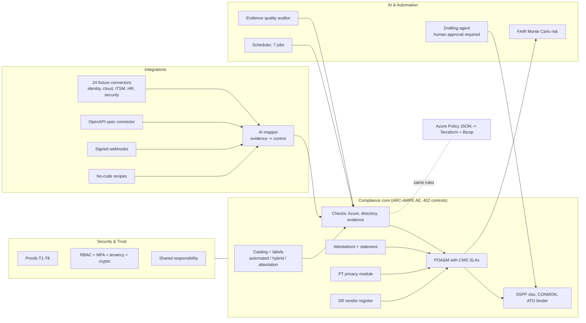
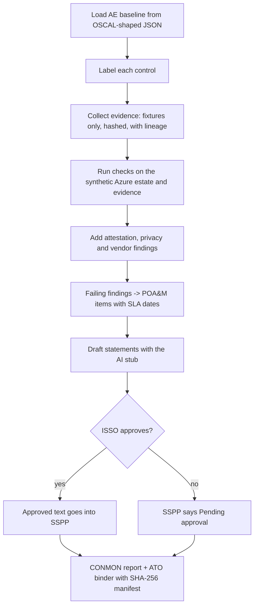

# Jagadish-arc-ampe-compliance-automation

**Compliance automation for an ACA Administering Entity under CMS ARC-AMPE: 402 controls, each labelled
automated, hybrid or attestation, with checks, a POA&M, an SSPP workbook, a CONMON report and an ATO binder.**

> **Recruiter summary.** State health exchanges and their vendors must meet ARC-AMPE (CMS's NIST
> SP 800-53 Rev 5 based baseline) and rebuild the same evidence by hand every year. This repo turns
> the 402-control AE baseline into code: 65 controls are checked by machine, 207 need a machine check
> plus a human, and 130 need a signed attestation that goes stale on a clock. Failing checks become
> POA&M items with CMS SLA dates; an AI drafter writes control statements that only a human ISSO can
> approve. Proof below is printed by real runs: the test count, 531 findings on a synthetic Azure
> estate, 5 planted misconfigurations caught, Azure Policy and Python checks agreeing on 6 of 6, and
> a byte-for-byte reproducible ATO binder.

**Everything is synthetic.** The entity (Lakehaven Health Connector, `lakehaven-hx.example`), its
people, vendors and Azure estate are fictional. Nothing is deployed, billed or connected to a real API.
Nothing here is a CMS ATO, a FedRAMP authorization, a SOC 2 report or any other certification; the trust
material is a **self-assessment design**.

<!-- run: python scripts/count_tests.py -->
```text
1075 tests collected
```
<!-- /run -->

## Purpose and who it is for

| Reader | What they get |
|---|---|
| ISSO / compliance lead at a state exchange or Medicaid E&E vendor | A control-by-control plan of what can be automated and what must stay a signature |
| Cloud / platform engineer | Python checks plus the same rules as Azure Policy in Terraform and Bicep |
| Assessor | A binder with a SHA-256 manifest, evidence lineage and a POA&M that is rebuilt from findings |
| Recruiter / hiring manager | Evidence of GRC engineering, Azure, IaC, test discipline and safe AI use |

## Architecture

Three platform areas sit around the compliance core.



## How it works, step by step



1. **Catalog.** `arcampe/catalog.py` loads the 402-control AE baseline. Each control gets one label.
2. **Evidence.** Connectors read JSON fixtures, hash each record and record where it came from.
3. **Checks.** 30 Azure checks, 13 identity/evidence checks, attestation clocks, privacy and vendor checks.
4. **POA&M.** Every failing finding becomes an item with a due date from CMS SLA days (15/30/90/365).
5. **Statements.** An AI drafter (deterministic stub offline) writes a draft; only a human ISSO can approve.
6. **Outputs.** SSPP workbook, CONMON Markdown/HTML and a zip binder whose manifest can be re-verified.

## Control counts by family and label (real run)

<!-- run: python -m arcampe catalog -->
```text
| Family | Name | Controls | Automated | Hybrid | Attestation |
|---|---|---:|---:|---:|---:|
| AC | Access Control | 51 | 14 | 36 | 1 |
| AT | Awareness and Training | 9 | 0 | 2 | 7 |
| AU | Audit and Accountability | 19 | 9 | 9 | 1 |
| CA | Assessment, Authorization, and Monitoring | 12 | 1 | 7 | 4 |
| CM | Configuration Management | 31 | 6 | 24 | 1 |
| CP | Contingency Planning | 23 | 3 | 12 | 8 |
| IA | Identification and Authentication | 24 | 6 | 17 | 1 |
| IR | Incident Response | 16 | 1 | 8 | 7 |
| MA | Maintenance | 16 | 0 | 2 | 14 |
| MP | Media Protection | 9 | 0 | 1 | 8 |
| PE | Physical and Environmental Protection | 19 | 0 | 0 | 19 |
| PL | Planning | 6 | 0 | 1 | 5 |
| PM | Program Management | 28 | 0 | 2 | 26 |
| PS | Personnel Security | 9 | 1 | 1 | 7 |
| PT | Personally Identifiable Information Processing and Transparency | 10 | 0 | 7 | 3 |
| RA | Risk Assessment | 12 | 2 | 8 | 2 |
| SA | System and Services Acquisition | 34 | 2 | 21 | 11 |
| SC | System and Communications Protection | 34 | 13 | 20 | 1 |
| SI | System and Information Integrity | 34 | 6 | 27 | 1 |
| SR | Supply Chain Risk Management | 6 | 1 | 2 | 3 |
| **All** | 20 families | **402** | **65** | **207** | **130** |
```
<!-- /run -->

Labels: **automated** = a machine check decides; **hybrid** = a machine check plus a human step;
**attestation** = a named owner signs on a schedule. "Automated" is computed from the check registries, so a
control is only called automated if tested code checks it. The hybrid/attestation split is a rule set in
`arcampe/labels.py` (the author's judgement, not a CMS designation).

## Measured results (synthetic estate, real runs)

<!-- run: python -m arcampe trust -->
```text
T1 PASS Secure by design
T2 PASS Continuous monitoring (threat detection, vulnerability scanning)
T3 PASS Data protection (encryption in transit and at rest, strict access)
T4 PASS Compliance aligned (NIST 800-53, FedRAMP-style baseline)
T5 PASS Isolated multi-tenant cloud
T6 PASS Least privilege (RBAC plus MFA)
T7 PASS Audited and tested (pen test and assessment evidence)
T8 PASS Backup and disaster recovery (automated backup and restore tests)
```
<!-- /run -->

<!-- run: python -m arcampe integrations -->
```text
153 evidence records, 153 hash-verified
```
<!-- /run -->

<!-- run: python -c "from arcampe import assess, iac; from arcampe.checks.registry import load_estate; print(iac.parity(load_estate(), assess.run_all()))" -->
```text
{'policy_hits': 6, 'python_fails': 6, 'both': 6, 'policy_only': [], 'python_only': []}
```
<!-- /run -->

<!-- run: python -m arcampe attest -->
```text
{"current": 90, "due_soon": 14, "overdue": 16, "missing": 10, "total": 130}
[draft, not sent] to=ciso cc=isso subject='[ARC-AMPE] 11 attestation(s) need your signature'
[draft, not sent] to=continuity-lead cc=None subject='[ARC-AMPE] 3 attestation(s) need your signature'
[draft, not sent] to=facilities-security cc=isso subject='[ARC-AMPE] 6 attestation(s) need your signature'
[draft, not sent] to=hr-security-liaison cc=isso subject='[ARC-AMPE] 1 attestation(s) need your signature'
[draft, not sent] to=ir-lead cc=None subject='[ARC-AMPE] 1 attestation(s) need your signature'
[draft, not sent] to=isso cc=isso subject='[ARC-AMPE] 6 attestation(s) need your signature'
[draft, not sent] to=it-ops-manager cc=isso subject='[ARC-AMPE] 4 attestation(s) need your signature'
[draft, not sent] to=procurement-lead cc=isso subject='[ARC-AMPE] 2 attestation(s) need your signature'
[draft, not sent] to=training-lead cc=isso subject='[ARC-AMPE] 6 attestation(s) need your signature'
```
<!-- /run -->

| Result | Value | Kind |
|---|---|---|
| Findings | 531 (428 pass, 103 fail) | measured on synthetic data |
| Azure checks | 261 pass, 47 fail; 5 of 5 planted misconfigurations caught | measured on synthetic data |
| POA&M | 103 open: 2 critical, 41 high, 59 moderate, 1 low; 22 overdue | measured on synthetic data |
| Attestations | 90 current, 14 due soon, 16 overdue, 10 missing | synthetic, seeded |
| Evidence mapper | precision 0.983, recall 0.95 at 0.6 on 60 self-labelled items | regression check, not a quality claim |
| Detection rules | 5 of 5 synthetic scenarios, 0 false positives | rules written knowing the scenarios |
| FAIR R01 ransomware | P90 annual loss $1,622,964; P50 $0 | synthetic inputs, seed 20261031 |
| Audit readiness | 57.5 / 100 (only 12 of 402 statements approved) | measured on synthetic data |
| ATO binder | 92,186 bytes, identical bytes on every build | measured |

## How to run (offline)

```bash
python -m venv .venv && . .venv/bin/activate
pip install -r requirements-dev.txt
python -m pytest -q
python -m arcampe all --out out        # SSPP, POA&M, CONMON, binder and the rest into ./out
python scripts/render_docs.py --check  # docs still match a fresh run
```

Optional IaC checks (no Azure login needed, nothing deployed):

```bash
cd infra/terraform && terraform init -backend=false && terraform validate && terraform test
az bicep build --file infra/bicep/main.bicep
```

## Guardrails

- **No network.** Connectors read fixtures; `call_api()` raises `NetworkDisabled`; a test scans the package for network imports.
- **Human approval.** AI drafts cannot be approved by an agent or by the drafter; empty notes are refused; only approved text reaches the SSPP.
- **Prompt hygiene.** Notes are screened for injection and SSNs, phones and emails are redacted before drafting.
- **Separation of duties.** Owners cannot approve their own policies, validate their own audit fixes or sign off their own evidence.
- **Reminders are drafts.** Attestation and SLA emails are printed as drafts and never sent.
- **IaC is Audit only by default.** Azure Policy effect defaults to `Audit`; there is no deploy workflow.

## Limitations

- The DEE baseline (308 controls) comes from a third-party parse and is not verified against CMS.
- FedRAMP Moderate is approximated by NIST SP 800-53B Moderate, not the FedRAMP baseline.
- Crosswalks to HIPAA, SOC 2, ISO 27001, PCI DSS, GDPR, CCPA and COBIT are author-built.
- FAIR inputs, detection scenarios and mapper labels are synthetic and written by the author.
- RPO under 24 hours cannot be shown from day-level backup data and is reported as **unproven**.
- Connector payloads are simplified shapes, not real vendor API responses.

See [docs/limitations.md](docs/limitations.md).

## Built vs planned

| Status | Item |
|---|---|
| Built | Catalog and labels, 43 checks, attestations, PT and SR modules, POA&M, SSPP, CONMON, binder, crosswalks, AI drafter (stub), integrations, risk, trust proofs T1-T8, Azure Policy, CI |
| Written, not run against Azure | Terraform and Bicep (validated, tested with a mock provider, never applied) |
| Planned | Microsoft Foundry backend for the drafter, live connectors, a real-time dashboard, verification of the DEE baseline |

## Docs

| Doc | What it covers |
|---|---|
| [AGENTIC_AI_PLAN.md](AGENTIC_AI_PLAN.md) | The three platform areas and the agent plan |
| [docs/purpose.md](docs/purpose.md) | Problem, users, scope |
| [docs/architecture.md](docs/architecture.md) | Modules and data flow |
| [docs/how-it-works.md](docs/how-it-works.md) | Step by step with real output |
| [docs/how-to-run.md](docs/how-to-run.md) | Commands |
| [docs/control-catalog.md](docs/control-catalog.md) | Labels and why |
| [docs/crosswalks.md](docs/crosswalks.md) | HIPAA, FedRAMP proxy, SOC 2 and more |
| [docs/SECURITY_AND_TRUST.md](docs/SECURITY_AND_TRUST.md) | T1-T8 proofs, responsibility, attestations map |
| [docs/INTEGRATIONS.md](docs/INTEGRATIONS.md) | 4 methods, evidence schema, mapper |
| [docs/risk-faq.md](docs/risk-faq.md) | Cyber risk lifecycle and 6 FAQs |
| [docs/SOURCE_COVERAGE.md](docs/SOURCE_COVERAGE.md) | Reference capability areas vs this repo |
| [docs/guardrails.md](docs/guardrails.md) · [docs/threat-model.md](docs/threat-model.md) · [docs/limitations.md](docs/limitations.md) | Safety |
| [docs/implementation-guide.md](docs/implementation-guide.md) · [docs/interview-points.md](docs/interview-points.md) · [docs/adr/](docs/adr/) | Adoption and decisions |

## Related repos

- [Jagadish-enterprise-ai-trust-pack](https://github.com/jagadishmazure-jpg/Jagadish-enterprise-ai-trust-pack): buyer-facing trust evidence for AI vendors; this repo reuses its doc rendering and brand-check approach.
- [Jagadish-ml-threat-model-lab](https://github.com/jagadishmazure-jpg/Jagadish-ml-threat-model-lab): threat modelling for ML systems.

## Sources

- NIST SP 800-53 Rev 5 OSCAL catalog (public domain, NIST).
- CMS ARC-AMPE Vol II SSPP workbook, ACA AE v1.02 (public CMS document); parameter values restated in `arcampe/params.py`.
- Capability areas were compared with a commercial GRC vendor's public pages; see [docs/SOURCE_COVERAGE.md](docs/SOURCE_COVERAGE.md).

MIT licence. Not legal or compliance advice.
