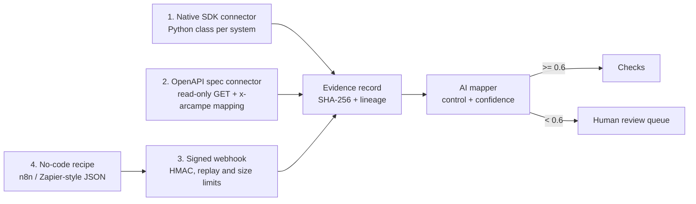

# Integrations

> Generic fixture data only and no real API calls. Every connector reads a JSON file in
> `data/fixtures/connectors/`. `call_api()` raises `NetworkDisabled`.

## Four methods

| Method | Code | When to use |
|---|---|---|
| Native SDK | `arcampe/integrations/sdk.py`, `connectors.py` | Systems you pull from on a schedule |
| OpenAPI | `arcampe/integrations/openapi.py`, `data/openapi/*.json` | Any REST API with a spec; no new Python |
| Webhook | `arcampe/integrations/webhooks.py` | Systems that push events |
| No-code | `arcampe/integrations/nocode.py`, `examples/nocode/` | Business teams wiring SaaS tools without code |

## Fixture connectors (live count)

<!-- run-md: python -m arcampe.docs_tables connectors -->
| Connector | Category | Method | Technology it stands in for | Records |
|---|---|---|---|---:|
| entra_id | identity | native-sdk | Microsoft Entra ID (Graph API) | 5 |
| active_directory | identity | native-sdk | Active Directory (LDAP export) | 3 |
| okta | identity | native-sdk | Okta (Users API) | 3 |
| azure_resource_graph | cloud | native-sdk | Azure Resource Graph | 12 |
| defender_for_cloud | cloud | native-sdk | Microsoft Defender for Cloud | 4 |
| sentinel | cloud | native-sdk | Microsoft Sentinel | 8 |
| purview | cloud | native-sdk | Microsoft Purview | 2 |
| aws_security_hub | cloud | native-sdk | AWS Security Hub | 2 |
| gcp_scc | cloud | native-sdk | Google Cloud Security Command Center | 1 |
| servicenow | itsm | native-sdk | ServiceNow (Table API) | 4 |
| jira | itsm | native-sdk | Jira (REST API) | 2 |
| m365 | collaboration | native-sdk | Microsoft 365 (admin settings) | 2 |
| slack | collaboration | native-sdk | Slack (admin settings) | 1 |
| sharepoint | collaboration | native-sdk | SharePoint Online | 3 |
| splunk | security | native-sdk | Splunk (saved searches) | 1 |
| tenable | security | native-sdk | Tenable (scans API) | 2 |
| qualys | security | native-sdk | Qualys (host list) | 2 |
| palo_alto | security | native-sdk | Palo Alto Networks firewall (rulebase) | 3 |
| datadog | security | native-sdk | Datadog (monitors) | 3 |
| github | devops | native-sdk | GitHub (repos and pulls API) | 7 |
| docs_library | docs | native-sdk | Document library (policy store) | 20 |
| hris | hr | native-sdk | HR information system (people events and training) | 47 |
| finance_vendors | finance | native-sdk | Accounts payable vendor master | 5 |
| backup_jobs | platform | native-sdk | Azure Backup job history | 11 |
<!-- /run-md -->

"Technology it stands in for" names the kind of product a real connector would read. The fixture shapes
are simplified and are not copies of those products' API responses.

## Evidence schema

| Field | Meaning |
|---|---|
| `tenant_id` | Whose evidence; required |
| `source`, `category`, `kind` | Where it came from and what it is |
| `subject`, `observed_at`, `attributes` | The fact itself |
| `control_hints` | Controls the source suggests |
| `content_sha256` | SHA-256 of the canonical JSON of the core fields |
| `evidence_id` | `ev-` + first 16 hex of the hash |
| `lineage` | Steps (fetch, normalize, webhook-verify) each with input and output hashes |

`schema.verify()` fails if any core field changes or the last lineage step does not end at the hash.

## Webhook rules (tested)

| Case | Status |
|---|---:|
| Good signature, new id | 202 |
| Same signature again (replay) | 409 |
| Same id, new signature (retry) | 200, same evidence |
| Missing or bad signature, or timestamp off by > 300 s | 401 |
| Malformed header or body not JSON with an id | 400 |
| Body too large | 413 |
| Cannot normalise (bad category) | 422 |

Secret rotation: the receiver accepts the current and previous secret during a rotation window.

## AI mapper

A keyword and hint scorer (deterministic, no model call) suggests one control per evidence record.

<!-- run-md: python -m arcampe.docs_tables mapper -->
| Threshold | Auto-mapped | Sent to review | Precision | Recall |
|---:|---:|---:|---:|---:|
| 0.5 | 58 | 2 | 0.983 | 0.95 |
| 0.55 | 58 | 2 | 0.983 | 0.95 |
| 0.6 | 58 | 2 | 0.983 | 0.95 |
| 0.7 | 54 | 6 | 0.981 | 0.883 |
| 0.8 | 54 | 6 | 0.981 | 0.883 |
| 0.9 | 51 | 9 | 0.98 | 0.833 |

60 items, labelled by the author. A regression check, not a quality claim.
<!-- /run-md -->

## Six challenge modules

| Challenge | Module | What it does |
|---|---|---|
| Fragmented visibility | `challenges/visibility.py` | One view of findings by source and family |
| Inconsistent assessment | `challenges/scoring.py` | Maps CVSS, Qualys 1-5, severity words and LxI scores to one 0-10 band |
| Missing business context | `challenges/business_context.py` | Weights findings by the service they hit; flags over-appetite |
| Slow response | `challenges/response.py` | Routes POA&M items by SLA state; escalation |
| Third-party oversight | `challenges/third_party.py` | Vendor scores plus evidence signals |
| Audit readiness | `challenges/audit_readiness.py` | One readiness score and the assessor request list |
