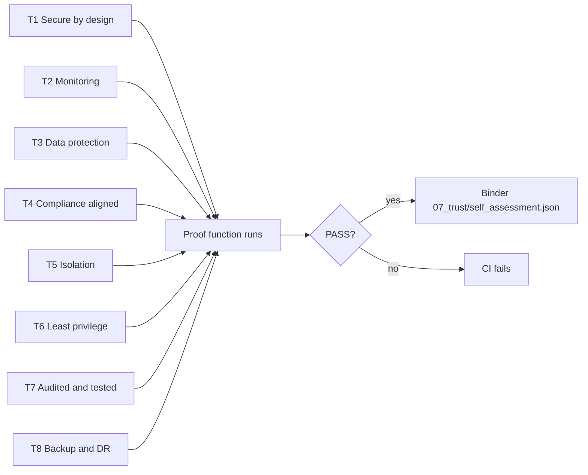

# Security & Trust

> **In one line:** eight security claims (T1-T8), each proven by code and a test, plus shared responsibility and AI safety rules.
>
> **Read this if:** a customer's security team asks how the platform itself is secured.

> **Do not claim any real certification. This is a self-assessment design.** Every result below is a
> function in this repo running on synthetic data. No auditor, 3PAO, QSA or covered entity has reviewed it.

## Cheat sheet

## Proofs T1-T8 (live run)

Each row names the code, the test that guards it, and the author-built references to NIST SP 800-53,
SOC 2 Type II Trust Services Criteria, ISO/IEC 27001:2022 Annex A and the HIPAA Security Rule.

<!-- run-md: python -m arcampe.docs_tables trust -->
| ID | Claim | Result | Proof (live run) | Code | Test | NIST 800-53 | SOC 2 TSC | ISO 27001:2022 | HIPAA |
|---|---|---|---|---|---|---|---|---|---|
| T1 | Secure by design | PASS | 0 network imports or hard-coded URLs in package; connectors refuse live calls | `arcampe/platform/secure_ai.py, arcampe/integrations/sdk.py` | `tests/test_platform.py::test_no_network_code` | SA-08, SA-11, SC-07 | CC8.1 | A.8.25, A.8.27 | 164.308(a)(1) |
| T2 | Continuous monitoring (threat detection, vulnerability scanning) | PASS | 5/5 synthetic attack scenarios detected, 0 false positives; 4 scanner feeds | `arcampe/platform/monitoring.py` | `tests/test_platform.py::test_detection` | SI-04, RA-05, CA-07 | CC7.1, CC7.2 | A.8.8, A.8.16 | 164.308(a)(1)(ii)(D) |
| T3 | Data protection (encryption in transit and at rest, strict access) | PASS | AES-256-GCM per tenant; cross-tenant decrypt fails; TLS < 1.2 rejected | `arcampe/platform/crypto.py` | `tests/test_platform.py::test_crypto_cross_tenant` | SC-08, SC-13, SC-28, SC-12 | CC6.1, CC6.7 | A.8.24 | 164.312(a)(2)(iv), 164.312(e)(1) |
| T4 | Compliance aligned (NIST 800-53, FedRAMP-style baseline) | PASS | 402 ARC-AMPE AE controls catalogued; 270 also in the NIST Moderate baseline (FedRAMP-style proxy) | `arcampe/catalog.py` | `tests/test_catalog.py` | CA-02, PL-02 | CC4.1 | A.5.36 | 164.316(a) |
| T5 | Isolated multi-tenant cloud | PASS | cross-tenant read denied and logged | `arcampe/platform/tenancy.py` | `tests/test_platform.py::test_tenant_isolation` | AC-04, SC-04, SC-02 | CC6.1 | A.8.3 | 164.312(a)(1) |
| T6 | Least privilege (RBAC plus MFA) | PASS | privileged actions need phishing-resistant MFA; agents cannot approve | `arcampe/platform/rbac.py` | `tests/test_platform.py::test_rbac` | AC-06, AC-05, IA-02(01) | CC6.3 | A.5.15, A.8.2, A.8.5 | 164.312(d), 164.308(a)(4) |
| T7 | Audited and tested (pen test and assessment evidence) | PASS | VA, pen test and control assessment within cadence; 1 mislabelled or weak record(s) flagged | `arcampe/platform/assurance.py` | `tests/test_platform.py::test_assurance` | CA-02, CA-08, RA-05 | CC4.1 | A.5.35, A.8.8 | 164.308(a)(8) |
| T8 | Backup and disaster recovery (automated backup and restore tests) | PASS | restore drill 5 objects hash-matched; 2/4 backup targets meet daily/weekly/3-generation | `arcampe/platform/backup.py` | `tests/test_platform.py::test_backup` | CP-09, CP-09(01), CP-10 | A1.2, A1.3 | A.8.13, A.5.30 | 164.308(a)(7) |
<!-- /run-md -->

## Secure AI processing

Rules for any hosted model (planned: Microsoft Foundry). The repo checks a config file against them:

<!-- run-md: python -m arcampe.docs_tables ai_config -->
| Rule | Pass | Detail |
|---|---|---|
| private endpoint | yes | required |
| public network access off | yes | Disabled |
| endpoint on allow-list | yes | aif-lhx-prod.services.ai.azure.com |
| no training on customer data | yes | contract + config |
| zero data retention configured | yes | 0 |
| U.S. region | yes | eastus2 |
| PII redaction before prompt | yes | redact.py |
| key-less auth (managed identity) | yes | Entra ID only |
<!-- /run-md -->

Before any text reaches a model: injection screen, then redaction of SSNs, phones, emails and Medicaid IDs
(`secure_ai.prepare_prompt`). Egress is allow-listed by host name; IP literals are refused.
Zero data retention is a configuration claim; in real Azure it needs Microsoft's approval to opt out of
abuse monitoring, so treat it as "requested", not "proven".

## Shared responsibility

Three parties: the platform vendor (this software), Azure (the cloud), and the customer (the AE).
P = primary, S = supporting. Full CSV: [shared_responsibility.csv](shared_responsibility.csv).

<!-- run-md: python -m arcampe.docs_tables responsibility -->
| Family | Controls | Platform vendor | Azure | Customer | Notes |
|---|---:|:-:|:-:|:-:|---|
| AC Access Control | 51 | S | S | P | Vendor builds RBAC and tenant isolation; Azure provides Entra ID; customer assigns roles and reviews access |
| AT Awareness and Training | 9 | S | - | P | Vendor trains its own staff; customer trains its workforce |
| AU Audit and Accountability | 19 | P | S | S | Vendor keeps the hash-chained audit trail; Azure Monitor stores logs; customer reviews weekly |
| CA Assessment, Authorization, and Monitoring | 12 | S | I | P | Customer owns the ATO and assessments; vendor supplies its own assessment evidence |
| CM Configuration Management | 31 | P | S | S | Vendor runs change control for the platform; customer controls its own configs |
| CP Contingency Planning | 23 | P | S | S | Vendor backs up and restore-tests the platform; Azure supplies zone redundancy |
| IA Identification and Authentication | 24 | S | P | S | Entra ID authenticates; vendor enforces MFA for privileged actions; customer manages users |
| IR Incident Response | 16 | S | S | P | Each party handles its own incidents; vendor notifies customer within 1 hour |
| MA Maintenance | 16 | S | P | - | Azure maintains hardware; vendor patches platform software |
| MP Media Protection | 9 | - | P | S | Azure sanitizes physical media; customer handles its own exports |
| PE Physical and Environmental Protection | 19 | - | P | - | Fully inherited from Azure data centers |
| PL Planning | 6 | S | - | P | Customer owns the SSPP; vendor provides the platform system description |
| PM Program Management | 28 | - | - | P | Program management is the customer's |
| PS Personnel Security | 9 | S | S | P | Each party screens and offboards its own people |
| PT Personally Identifiable Information Processing and Transparency | 10 | S | - | P | Customer decides PII purposes and notices; vendor redacts PII before AI prompts |
| RA Risk Assessment | 12 | S | S | P | Customer owns risk decisions; vendor scans the platform |
| SA System and Services Acquisition | 34 | P | S | S | Vendor runs secure development; customer manages acquisition of the platform |
| SC System and Communications Protection | 34 | P | S | S | Vendor encrypts and isolates; Azure supplies network and key services |
| SI System and Information Integrity | 34 | P | S | S | Vendor patches and monitors the platform; customer monitors its own estate |
| SR Supply Chain Risk Management | 6 | S | S | P | Customer manages its supply chain; vendor manages its own sub-processors |

Primary owner per control (402 AE controls): {'platform_vendor': 175, 'azure': 68, 'customer': 159}
<!-- /run-md -->

## Attestation readiness map (self-assessment only)

<!-- run-md: python -m arcampe.docs_tables attestations -->
> Self-assessment readiness only. Not a FedRAMP authorization, PCI attestation or signed BAA.

**FedRAMP Moderate (proxy: NIST 800-53B Moderate)**

| Area | Code | Test | Status |
|---|---|---|---|
| Control baseline coverage | `arcampe/catalog.py` | `tests/test_catalog.py` | ready |
| Continuous monitoring (monthly scans, POA&M) | `arcampe/conmon.py, arcampe/poam.py` | `tests/test_poam.py` | ready |
| System security plan | `arcampe/sspp.py` | `tests/test_sspp.py` | partial |
| Independent assessment (3PAO) | `arcampe/platform/assurance.py` | `tests/test_platform.py` | gap |
| FIPS 140 validated cryptography | `arcampe/platform/crypto.py` | `tests/test_platform.py` | partial |
| Incident reporting | `arcampe/incident.py` | `tests/test_solutions.py` | ready |

**PCI DSS v4.0 SAQ D (service provider)**

| Area | Code | Test | Status |
|---|---|---|---|
| Req 1 network security controls | `arcampe/checks/registry.py (AZ-01, AZ-13)` | `tests/test_checks.py` | ready |
| Req 3 protect stored account data | `arcampe/platform/crypto.py` | `tests/test_platform.py` | partial |
| Req 4 strong cryptography in transit | `arcampe/checks/registry.py (AZ-04)` | `tests/test_checks.py` | ready |
| Req 6 secure development and patching | `arcampe/checks/evidence_checks.py (EV-05), registry AZ-19` | `tests/test_checks.py` | ready |
| Req 8 identification and MFA | `arcampe/platform/rbac.py` | `tests/test_platform.py` | ready |
| Req 10 logging and monitoring | `arcampe/platform/audit_log.py` | `tests/test_platform.py` | ready |
| Req 11 testing (scans, pen test) | `arcampe/platform/assurance.py` | `tests/test_platform.py` | ready |
| Req 12.8 third-party service providers | `arcampe/supply_chain.py` | `tests/test_supply_chain.py` | ready |
| Cardholder data scope | `-` | `-` | gap |

**HIPAA BAA readiness**

| Area | Code | Test | Status |
|---|---|---|---|
| Safeguards per 164.308-164.312 | `arcampe/crosswalk.py` | `tests/test_crosswalk.py` | ready |
| Breach notification to covered entity | `arcampe/incident.py` | `tests/test_solutions.py` | ready |
| Subcontractor flow-down | `arcampe/supply_chain.py (SR-FLOW)` | `tests/test_supply_chain.py` | ready |
| Return or destroy PHI at termination | `-` | `-` | gap |
| Access to PHI for individual rights | `arcampe/privacy.py (rights_requests)` | `tests/test_privacy.py` | partial |
<!-- /run-md -->

## Pen test vs vulnerability assessment, and cadence

<!-- run-md: python -m arcampe.docs_tables assurance -->
| Record | Labelled as | Evidence shows | OK | Issues |
|---|---|---|---|---|
| VA-2026-10 | vulnerability_assessment | vulnerability_assessment | yes |  |
| VA-2026-09 | vulnerability_assessment | vulnerability_assessment | yes |  |
| PT-2026-01 | penetration_test | penetration_test | yes |  |
| PT-2025-02 | penetration_test | vulnerability_assessment | no | labelled penetration_test but evidence shows vulnerability_assessment; not performed by an independent assessor |
| SCA-2026 | control_assessment | control_assessment | yes |  |

| Type | Control | Every (days) | Also when | Last | Next due | OK |
|---|---|---:|---|---|---|---|
| vulnerability_assessment | RA-05 | 30 | new critical CVE or major change | 2026-10-12 | 2026-11-11 | yes |
| penetration_test | CA-08 | 365 | major release or architecture change | 2026-03-20 | 2027-03-20 | yes |
| control_assessment | CA-02 | 365 | significant change or new ATO | 2026-06-30 | 2027-06-30 | yes |
<!-- /run-md -->

A record labelled "penetration test" that shows no exploitation or rules of engagement is flagged:
a scan is not a pen test.

## Change management and incident response

<!-- run-md: python -m arcampe.docs_tables procedures -->
**Change management (CM-03, CM-04, CM-05)**

| Step | Owner | Evidence |
|---|---|---|
| Request: describe the change, systems and data touched | requester | `ticket` |
| Security impact analysis | isso | `impact_analysis` |
| Peer review of code or config | engineer (not the author) | `approved_pr` |
| Test in non-production | engineer | `test_evidence` |
| Change advisory approval | change board | `approval` |
| Deploy through pipeline only | pipeline | `deployment_log` |
| Verify and close; update baseline and SSPP if needed | requester | `closure_note` |

Emergency changes may deploy first but need review and approval within 2 business days.

**Incident response (IR-04, IR-06, IR-08)**

| Phase | Target | Action |
|---|---|---|
| Detect and log | at once | Create incident with time detected, reporter and systems |
| Classify | 15 minutes | Severity and whether PII is involved |
| Report to CMS | 1 hour | PII incidents to CMS within one hour of discovery (IR-06, ARC-AMPE) |
| Contain | 4 hours | Isolate hosts, revoke tokens, block indicators |
| Preserve evidence | with containment | Chain of custody: hash every artifact, log every handler |
| Eradicate and recover | per plan | Remove cause, restore from tested backups |
| Notify individuals | per law | Breach notices where required |
| Post-incident review | 14 days | Root cause, lessons, POA&M items, update playbooks |
<!-- /run-md -->

## Documentation request pack

`procedures.doc_request_pack()` produces templates a customer's security team usually asks for:
a security whitepaper template, an architecture overview template and a request checklist. They are
marked TEMPLATE and must be filled in and approved by a security lead before sharing. See
[trust-pack/](trust-pack/).
