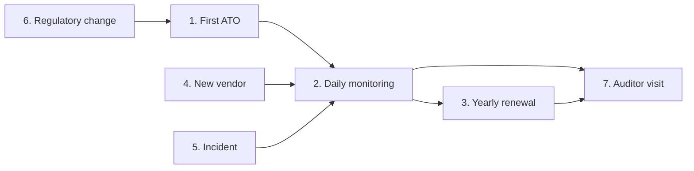
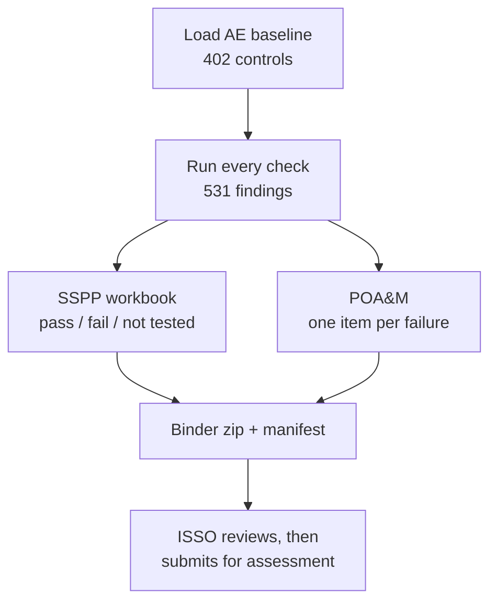
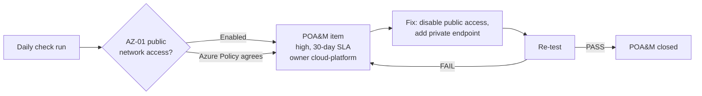
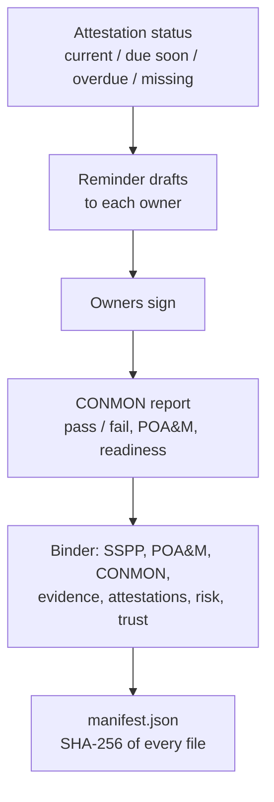
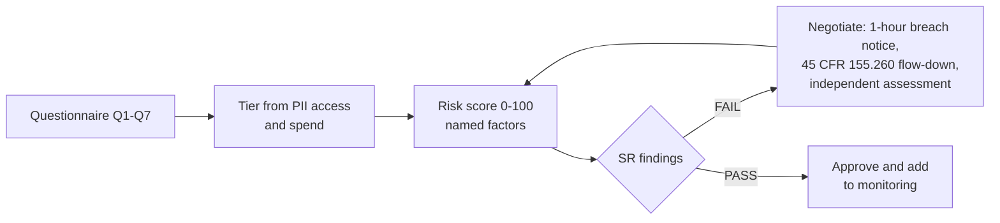
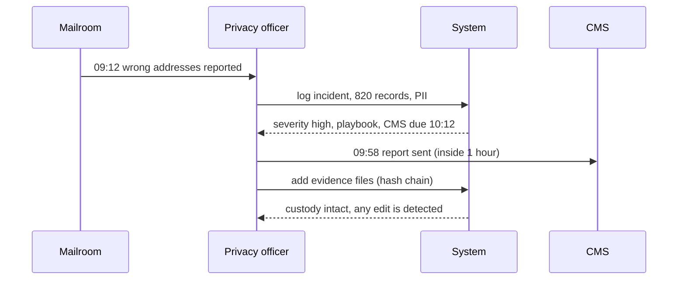
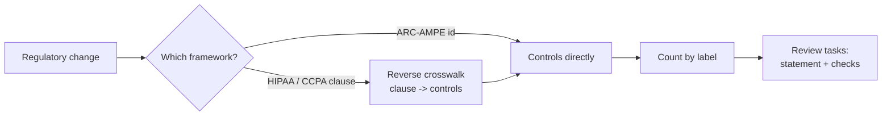
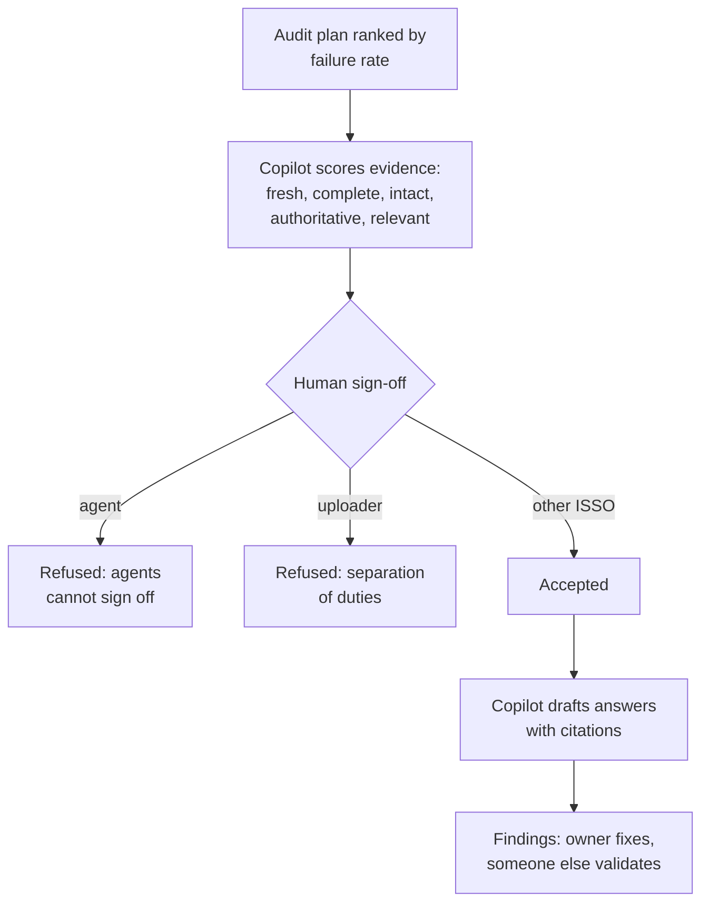

# Use cases, end to end

> **In one line:** fifteen real-world stories (first ATO, daily monitoring, yearly renewal, new vendor, privacy
> incident, regulatory change, auditor visit, leadership report, BU readiness, control drift, PR gate, AI
> accountability, identity recovery, multi-org industry packs, scanner evidence), each with who acts, what starts it, the exact commands, the real
> output and the result.
>
> **Read this if:** you want to see how a compliance team would actually use this repo day to day.

Everything below runs offline on the fictional Lakehaven Health Connector (`lakehaven-hx.example`). Every output
block is printed by `python -m arcampe.usecases <case>` and re-checked in CI, so the numbers cannot drift from the
code. This is a **self-assessment design**: nothing here is a CMS ATO, an Authority to Connect, a FedRAMP
authorization or any other certification. The "today" date in the data is 2026-10-31.

| # | Use case | Actor | Trigger | Main modules |
|---:|---|---|---|---|
| 1 | [First ATO package](#1-a-new-state-exchange-prepares-its-first-ato) | ISSO | New system needs authorization | catalog, assess, sspp, poam, binder |
| 2 | [Public storage caught and closed](#2-daily-monitoring-catches-a-public-storage-account) | Cloud platform team | Daily check run | checks, iac, poam |
| 3 | [Yearly renewal binder](#3-the-yearly-renewal-binder) | ISSO and control owners | Renewal date approaching | attest, conmon, binder |
| 4 | [New vendor onboarding](#4-onboarding-a-new-vendor-that-sees-pii) | Procurement lead | Contract request | supply_chain |
| 5 | [Privacy incident](#5-a-privacy-incident-with-the-1-hour-breach-clock) | Privacy officer | Misdirected mail reported | incident, privacy |
| 6 | [Regulatory change](#6-a-regulatory-change-hits-controls) | Compliance analyst | New or proposed rule | regchange, crosswalk |
| 7 | [Auditor with an AI copilot](#7-an-auditor-walkthrough-with-the-ai-copilot) | External assessor and ISSO | Audit fieldwork starts | audit, ai_auditor, agent, rbac |
| 8 | [Leadership report, previews only](#8-leadership-report-previews-only) | CISO and executives | Weekday 07:00 schedule | grc.reporting, ai_governance, resilience |
| 9 | [Readiness by business unit and framework](#9-readiness-by-business-unit-and-framework) | CISO | Quarterly planning | grc.workspaces, grc.frameworks |
| 10 | [Edited after approval goes back to review](#10-edited-after-approval-goes-back-to-review) | Control owner and GRC expert | A passing control's content changes | grc.review |
| 11 | [PR gate plus sealed audit package](#11-pr-gate-plus-sealed-audit-package) | Platform engineer and auditor | Pull request; audit fieldwork | grc.cac, grc.auditor |
| 12 | [AI accountability](#12-ai-accountability) | Board member, ISSO | Board asks about AI risk | grc.ai_governance, grc.mcp_server |
| 13 | [Identity recovery evidence](#13-identity-recovery-evidence) | Infrastructure lead | Annual contingency test | resilience |
| 14 | [Industry packs and multi-org mode](#14-industry-packs-and-multi-org-mode) | Compliance service team | Onboarding new client organisations | grc.industry_packs |
| 15 | [Scanner evidence for RA-5 and SI-2](#15-scanner-evidence-for-ra-5-and-si-2) | Vulnerability management lead | Monthly scan export | grc.scanner_import |

How they connect:



---

## 1. A new state exchange prepares its first ATO

- **Actor:** the ISSO (Information System Security Officer) of a new state-based exchange.
- **Trigger:** the exchange must show CMS it meets the ARC-AMPE baseline before it can go live.
- **Goal:** a complete, honest package: every control labelled, every failure tracked, one verifiable binder.



**Steps**

1. Load the baseline and its labels (`python -m arcampe catalog` prints the family table).
2. Run the first full assessment (`python -m arcampe assess`).
3. Build the SSPP workbook (`python -m arcampe sspp` writes `out/sspp.xlsx`).
4. Open POA&M items for every failure (`python -m arcampe poam` writes `out/poam.csv`).
5. Build and verify the binder (`python -m arcampe binder` writes `out/ato_binder.zip`).

<!-- run: python -m arcampe.usecases first_ato -->
```text
1. Load the AE baseline: 402 controls {'attestation': 130, 'automated': 65, 'hybrid': 207}
2. First full assessment: 531 findings, 428 pass, 103 fail
3. SSPP workbook status per control: {'fail': 84, 'not tested': 202, 'pass': 116}
4. POA&M opened automatically: 103 items {'critical': 2, 'high': 41, 'moderate': 59, 'low': 1}
5. Binder: 10 files, verify: intact
   same input, same bytes: True
```
<!-- /run -->

**Result:** in one run the ISSO knows exactly where the system stands: 116 controls pass, 84 fail and 202 are
"not tested" because they need a person (hybrid) or a signature (attestation). Nothing is hidden: "not tested" is
shown as its own status, never counted as a pass. The binder is reproducible, so the assessor can rebuild it and
get the same bytes.

---

## 2. Daily monitoring catches a public storage account

- **Actor:** the cloud platform team, with the ISSO watching the POA&M.
- **Trigger:** the daily check run (continuous monitoring) finds `stlhxstaticweb` reachable from the internet.
- **Goal:** detect it, track it with an owner and a due date, fix it, prove the fix, close the item.



**Steps**

1. The scheduler runs the Azure checks every day (`python -m arcampe schedule` simulates 30 days).
2. Three checks fail on the same storage account; the Azure Policy rule `arcampe-storage-no-public-network`
   flags it as well, so two independent layers agree.
3. Each failure becomes a POA&M item with an owner and a due date from the SLA (high = 30 days).
4. The team turns public access off and adds a private endpoint.
5. The next run re-tests the fixed configuration; no failures means no open POA&M items.

<!-- run: python -m arcampe.usecases conmon_public_storage -->
```text
Day 1, daily check run, failures on stlhxstaticweb:
  AZ-01 high     publicNetworkAccess=Enabled  controls=['SC-07', 'AC-04']
  AZ-02 high     0 approved private endpoint(s)  controls=['SC-07(04)', 'SC-07(05)']
  AZ-22 moderate Azure Policy compliance state=False  controls=['CM-06', 'CM-02']
  Azure Policy (offline evaluation) flags it too: ['arcampe-storage-no-public-network']
  POA&M POAM-C6EF1944 AZ-02 high owner=cloud-platform due=2026-11-20 (on_track)
  POA&M POAM-C455623B AZ-01 high owner=cloud-platform due=2026-11-30 (on_track)
  POA&M POAM-F1F8E4C4 AZ-22 moderate owner=cloud-platform due=2026-10-21 (overdue)
After the fix (public access off, private endpoint added), re-test:
  AZ-01 PASS publicNetworkAccess=Disabled
  AZ-02 PASS 1 approved private endpoint(s)
  AZ-22 PASS Azure Policy compliance state=True
Open POA&M items for stlhxstaticweb after re-test: 0 -> closed
```
<!-- /run -->

**Result:** the item went from detected to closed with a full trail: which check, which controls (SC-07, AC-04),
who owned it, when it was due and the passing re-test. One fact worth noticing: AZ-22 was already overdue because
the policy non-compliance was first seen earlier, so the dashboard shows it in red even though AZ-01 is new.

---

## 3. The yearly renewal binder

- **Actor:** the ISSO, with every control owner who must sign an attestation.
- **Trigger:** the yearly authorization renewal is coming up. (An Administering Entity also needs an Authority to
  Connect, ATC, to link to CMS systems; this repo calls its package the "ATO binder".)
- **Goal:** fresh attestations, a current CONMON report and a binder whose integrity can be proven.



**Steps**

1. Check attestation status (`python -m arcampe attest`). Reminders are drafts only; nothing is sent.
2. Produce the CONMON report (`python -m arcampe conmon` writes Markdown and HTML).
3. Build the binder and check the manifest (`python -m arcampe binder`).

<!-- run: python -m arcampe.usecases annual_renewal -->
```text
1. Attestations: {'current': 90, 'due_soon': 14, 'overdue': 16, 'missing': 10, 'total': 130}
2. Reminder drafts (not sent): 9, e.g. to=ciso subject='[ARC-AMPE] 11 attestation(s) need your signature'
3. CONMON: findings 428 pass / 103 fail; POA&M open 103 overdue 22 | readiness score 57.5
4. Binder contents:
   01_sspp/sspp.xlsx
   02_poam/poam.csv
   03_conmon/conmon.html
   03_conmon/conmon.md
   04_evidence/evidence.jsonl
   05_attestations/attestations.json
   06_risk/top10.md
   07_trust/self_assessment.json
   07_trust/shared_responsibility.csv
   manifest.json
5. Manifest entries: 9 | verify: intact
```
<!-- /run -->

**Result:** the renewal starts from facts, not a blank template: 26 attestations need work (16 overdue, 10
missing), 22 POA&M items are overdue, and the readiness score is 57.5. Those gaps are the to-do list before the
package goes out. The manifest lets anyone prove later that no file was changed after sign-off.

---

## 4. Onboarding a new vendor that sees PII

- **Actor:** the procurement lead, with the privacy officer.
- **Trigger:** a business team wants to hire Lumenfield Translation Services (fictional) to translate consumer
  notices, which means the vendor will see consumer PII.
- **Goal:** tier the vendor, find questionnaire and contract gaps, and only sign when the risk is acceptable.



**Steps**

1. Send the 7-question questionnaire and record the answers.
2. Score the vendor: the score is a sum of named factors, so anyone can see why it is high or low.
3. Run the SR findings (assessment age, U.S. data location, contract flow-down).
4. Fix the gaps in the contract, get an assessment, and re-score.

<!-- run: python -m arcampe.usecases new_vendor -->
```text
Vendor: Lumenfield Translation Services | PII: True | spend: $180,000 | tier: high
Questionnaire gaps: ['Q4 Will you notify us of a suspected breach within one hour?', 'Q5 Do you provide a software bill of materials (SBOM) for delivered software?', 'Q6 Do you flow down 45 CFR 155.260 privacy and security terms to subcontractors?']
Risk score (0-100): 46 moderate {'tier': 20, 'questionnaire_gaps': 16, 'assessment_stale': 10, 'open_issues': 0}
  SR-ASSESS SR-03     FAIL  Lumenfield Translation Services: last assessed None days ago
  SR-LOC    SA-09(05) PASS  Lumenfield Translation Services: data in US
  SR-FLOW   SR-03     FAIL  Lumenfield Translation Services: flow-down clause=False
After contract fixes and an assessment: 20 low {'tier': 20, 'questionnaire_gaps': 0, 'open_issues': 0}
```
<!-- /run -->

**Result:** the vendor started at 46 (moderate) with two failing SR findings. After the contract was fixed and an
assessment was done, the score fell to 20 (low); the remaining 20 points are the tier itself, because any vendor
with PII access stays "high" tier and keeps being monitored.

---

## 5. A privacy incident with the 1-hour breach clock

- **Actor:** the privacy officer, with the incident response team.
- **Trigger:** 820 renewal notices containing consumer PII were mailed to the wrong addresses.
- **Goal:** classify, follow the playbook, report to CMS inside 1 hour (the AE IR-06 parameter), and keep evidence
  that can be proven untouched.



**Steps**

1. Log the incident with its detection time and whether PII is involved.
2. Classify it (500 or more PII records = high) and follow the matching playbook.
3. Watch the deadlines: CMS report within 1 hour, post-incident review within 14 days.
4. Add each piece of evidence to a hash chain so it can be proven unchanged.
5. Mask SSNs in any notes before they are shared (the output counts full SSNs; it never prints one).

<!-- run: python -m arcampe.usecases privacy_incident -->
```text
Severity: high
Playbook: ['retrieve or confirm destruction', 'log recipients', 'risk-of-harm assessment', 'report to CMS within 1 hour', 'notify individuals if required']
Deadlines: {'post_incident_review': '2026-11-12T09:12:00', 'cms_report': '2026-10-29T10:12:00'}
CMS report sent 09:58, met 1-hour clock: True
Post-incident review done yet: False
Chain of custody intact: True
After editing one artifact: False
Full SSNs left in the notes after masking: 0 (before: 1)
```
<!-- /run -->

**Result:** the CMS clock was met (sent at 09:58, due at 10:12), the review is still open and shows as not yet
met, and the evidence chain breaks the moment one byte changes. The incident then feeds daily monitoring as new
POA&M and lessons-learned work.

---

## 6. A regulatory change hits controls

- **Actor:** the compliance analyst.
- **Trigger:** a regulator proposes or finalizes a change (the feed here is synthetic: a shorter CMS reporting
  window, a fictional state data-rights act and an HHS Security Rule update).
- **Goal:** know within minutes which controls are affected and open review tasks for them.



**Steps**

1. Add the change to the feed (in production: a reviewed subscription read by an analyst, not blind scraping).
2. Map it to controls, directly or through the reverse crosswalk.
3. Count the affected controls by label: automated ones need a check update, attestation ones need a new signature.
4. Open review tasks for each affected control.

<!-- run: python -m arcampe.usecases reg_change -->
```text
RC-01 Shorter incident reporting window proposed: 1 controls {'automated': 1}
   first controls: ['IR-06']
   first task: Review IR-06 implementation statement and checks
RC-02 Lakehaven consumer data rights act: 10 controls {'attestation': 3, 'hybrid': 7}
   first controls: ['PT-01', 'PT-02', 'PT-03', 'PT-04', 'PT-04(03)', 'PT-05']
   first task: Review PT-01 implementation statement and checks
RC-03 Security Rule update: encryption and MFA expectations: 74 controls {'hybrid': 53, 'automated': 19, 'attestation': 2}
   first controls: ['AC-01', 'AC-02', 'AC-02(01)', 'AC-02(02)', 'AC-02(03)', 'AC-02(04)']
   first task: Review AC-01 implementation statement and checks
```
<!-- /run -->

**Result:** a one-control change (IR-06) is a quick parameter update; the HIPAA Security Rule update touches 74
controls, 53 of them hybrid, which tells the team it is mostly people work, not code work.

---

## 7. An auditor walkthrough with the AI copilot

- **Actor:** an external assessor, the ISSO and internal audit. The AI copilot helps but never decides.
- **Trigger:** audit fieldwork starts.
- **Goal:** spend audit days where failures are, let the copilot pre-sort evidence, and keep every decision human.



**Steps**

1. Rank control families by failure rate and plan 60 audit days (`python -m arcampe audit`).
2. The copilot scores all evidence records; low scores come with reasons.
3. A person signs off. Code refuses an agent, and refuses anyone signing off their own upload.
4. The copilot drafts control answers with citations to checks and parameters; a human approves them
   (see [AUDIT_AUTOMATION_EXPLAINED.md](AUDIT_AUTOMATION_EXPLAINED.md), step 10).
5. Audit findings move open -> remediating -> validated -> closed, and the owner cannot validate their own fix.

<!-- run: python -m arcampe.usecases auditor_copilot -->
```text
1. Risk-based audit plan (first 5 of 18 families, 60 days):
   AT Awareness and Training                   fail rate 0.857 -> 5 days (high)
   SI System and Information Integrity         fail rate 0.375 -> 5 days (high)
   CM Configuration Management                 fail rate 0.346 -> 5 days (high)
   SR Supply Chain Risk Management             fail rate 0.294 -> 3 days (medium)
   PS Personnel Security                       fail rate 0.273 -> 3 days (medium)
2. Copilot pre-scores 153 evidence records: 101 ready for sign-off, 52 need better evidence, 0 signed off by AI
   weakest: docs_library AC-01 score 0.33 reasons ['freshness', 'relevance']
3. Human sign-off rules:
   sign-off by agent:copilot on its own upload: refused - agent:copilot lacks signoff_evidence
   sign-off by Riley Quist on its own upload: refused - separation of duties: cannot approve own work
   sign-off by Riley Quist on evidence uploaded by a connector: accepted
4. Copilot drafts the AC-02 answer: draft | citations: ['AZ-12', 'catalog:AC-02']
5. Finding AF-01 validation by its owner: refused - owner cannot validate own fix
   validated by internal-audit, then: closed
```
<!-- /run -->

**Result:** the assessor starts with Awareness and Training (86% failing) instead of reading 402 controls in
order, the copilot flags 52 weak evidence records before anyone wastes time on them, and every accept, approval
and closure carries a human name.

---

## 8. Leadership report, previews only

- **Actor:** CISO and executives.
- **Trigger:** Weekday 07:00 schedule.
- **Goal:** Leadership wants one short email a day and a fuller one on Monday, built from the same data as the audit.

<!-- run: python -m arcampe.usecases leadership_report -->
```text
1. Headline KPIs (every value is computed from the synthetic data):
   Controls passing (tested)          115 / 200                              [measured, synthetic]
   Failing controls                   85                                     [measured, synthetic]
   Evidence fresh                     84.3%                                  [measured, synthetic]
   POA&M overdue                      22                                     [measured, synthetic]
   Critical + high open               43                                     [measured, synthetic]
   Access review complete             97.9%                                  [measured, synthetic]
   SOC 2 path                         3 of 36 SOC 2 requirements checked     [measured, synthetic]
   Value waiting on security review   $135,000                               [SIMULATED]
2. Framework readiness rings (tested-pass controls / mapped controls), top 5:
   APRA CPS 230                        40.5%  (53/131, approximate)
   ISO/IEC 27018                       29.3%  (22/75, approximate)
   NIST AI RMF 1.0                     29.2%  (66/226, approximate)
   DORA                                28.8%  (113/392, approximate)
   NIST SP 800-53 Rev 5                28.6%  (115/402, native)
3. AI Governance & Accountability (weekly section):
   Agent decision explainability rate       96.7%  [measured, synthetic]
   Decision-audit pass rate                 96.0% (24/25 replayed)  [measured, synthetic]
   Agent monitoring coverage                83.3% (5/6)  [measured, synthetic]
   Human-approval SLA and override rate     median 9.0h; 11.7% edited  [measured, synthetic]
   Autonomy level mix                       suggest_only 5, act_with_approval 1, act_then_notify 0  [configuration]
   AI decision-rights coverage              80.0%  [configuration]
   Shadow AI exposure                       4 unapproved tools; 25.0% triaged within SLA  [measured, synthetic]
   AI vendor concentration index            top-1 60.0%, top-2 80.0%, fallback 60.0%  [measured, synthetic]
   AI regulatory readiness (approximate)    ISO/IEC 42001 27.6%; NIST AI RMF 1.0 29.2%; EU AI Act 23.0%  [measured, synthetic]
   Agent legal-risk incidents blocked       6 blocked (critical 3, high 2, moderate 1)  [measured, scripted attempts]
   AI program ROI                           5.8 analyst hours saved; $493 at $85/h; $0.04/run  [SIMULATED]
   AI provider outage drill                 2026-08-20: partial (Provider A unavailable for 8 hours)  [synthetic]
4. Identity recovery: measured 11.5h vs target 8h, 172 days since drill, checks 8/11
5. Previews written to out/reports/: daily.csv, daily.eml, daily.html, daily.pdf, weekly.csv, weekly.eml, weekly.html, weekly.pdf
6. Send attempt without config and approval: refused - no send config: previews only; approval flag not set; no transport supplied (this repo ships none)
```
<!-- /run -->

**Result:** a CISO reads readiness, trend and AI accountability in two minutes, and nothing is ever emailed without an approval flag, a config and a transport that the team adds itself.

---

## 9. Readiness by business unit and framework

- **Actor:** CISO.
- **Trigger:** Quarterly planning.
- **Goal:** The CISO asks which business unit is least ready and which frameworks need the most work.

<!-- run: python -m arcampe.usecases bu_workspaces_and_frameworks -->
```text
1. Readiness per business unit (tested-pass / tested):
   BU-MKT  Marketplace Platform          23.3%  pass 14, fail 46, untested 133, exceptions 1
   BU-CSO  Consumer Services             55.2%  pass 16, fail 13, untested 15, exceptions 1
   BU-INF  Infrastructure and Facilities  76.9%  pass 40, fail 12, untested 15, exceptions 0
   BU-PMO  Program Office                76.3%  pass 45, fail 14, untested 39, exceptions 1
2. Framework registry: {'frameworks': 34, 'by_coverage': {'native': 1, 'proxy': 1, 'approximate': 30, 'covered': 1, 'gap': 1}}
3. Three least-ready frameworks: [('Cyber Essentials', 5.7), ('Essential Eight', 8.6), ('SOX IT general controls', 13.0)]
```
<!-- /run -->

**Result:** Marketplace Platform (23.3%) gets the next sprint of remediation; framework rings show where approximate mappings are weakest.

---

## 10. Edited after approval goes back to review

- **Actor:** Control owner and GRC expert.
- **Trigger:** A passing control's content changes.
- **Goal:** A control was approved as passing, then someone edited its narrative.

<!-- run: python -m arcampe.usecases control_drift_review -->
```text
1. Review board: {'not_started': 0, 'in_progress': 1, 'submitted': 1, 'passing': 5, 'returned': 2, 'needs_review': 1}
2. Drift: AU-06 (owner owner-2) approved 02b84a4b6bd2, now ea9cd6c381ba -> needs_review
3. Submit with no evidence: refused - attach at least one piece of evidence before submitting
```
<!-- /run -->

**Result:** the edit is caught by a content hash and AU-06 drops to needs_review until an expert approves again.

---

## 11. PR gate plus sealed audit package

- **Actor:** Platform engineer and auditor.
- **Trigger:** Pull request; audit fieldwork.
- **Goal:** An engineer opens a PR that adds a network rule open to RDP; later the auditor needs a frozen, verifiable evidence set.

<!-- run: python -m arcampe.usecases pr_gate_and_audit_package -->
```text
1. Fix suggestions for current findings: 47
2. Pipeline gate on the PR: {'result': 'fail', 'new_failures': 1, 'blocking': 1, 'fixed': 1, 'blocking_ids': ['AZ-13:nsg-lhx-new'], 'override': 'security lead, with a written reason (logged)'}
3. Write during audit mode: refused - audit mode is on: AC-02 is read-only
4. Sampling plan: 22 groups, 66 items sampled
5. Package verify: intact
```
<!-- /run -->

**Result:** the PR is blocked for one new high finding while the fix it also contains is credited; the auditor's package verifies intact and writes during audit mode are refused.

---

## 12. AI accountability

- **Actor:** Board member, ISSO.
- **Trigger:** Board asks about AI risk.
- **Goal:** A board member asks whether AI agents can be explained, replayed and stopped.

<!-- run: python -m arcampe.usecases ai_accountability -->
```text
1. Copilot proposes a change through MCP: pending_approval CHG-001
2. Agent tries to approve it: refused - agents cannot approve changes
3. Human approves: applied
4. Decision rights gaps: ['AI-VENDOR'] coverage 80.0 %
5. Replay audit of agent decisions: {'sampled': 25, 'reproduced': 24, 'pass_rate': 96.0, 'failed': ['ev-a3ffd298bec86006'], 'population': 60}
6. Shadow AI: [('Free chatbot (personal accounts)', 'consumer-services-director', 'triaged'), ('Meeting transcriber app', 'ciso', 'triaged'), ('Slide generator plug-in', 'platform-director', 'overdue'), ('Browser AI extension', 'platform-director', 'open')]
7. Approved model and app register: {'entries': 5, 'by_status': {'approved': 3, 'conditional': 1, 'retired': 1}, 'uses': 7, 'uses_compliant': 3, 'inventory_coverage_pct': 83.3}
   BU-MKT                 Code assistant (enterprise tier)   data class pii not allowed; evaluation older than 180 days
   agent:tprm             Summarizer v0 (retired)            retired entry still in use; data class internal not allowed; evaluation older than 180 days
   agent:copilot          Foundry-hosted drafter             tool assign_owner not allowed
   BU-MKT                 Browser AI extension               not in register
```
<!-- /run -->

**Result:** agents can only propose; one stored decision that was altered is caught by replay; shadow AI tools have named owners; 3 of 7 AI uses sit inside their approved register scope.

---

## 13. Identity recovery evidence

- **Actor:** Infrastructure lead.
- **Trigger:** Annual contingency test.
- **Goal:** If the directory is lost, nothing else can be restored. Prove identity recovery works.

<!-- run: python -m arcampe.usecases identity_recovery -->
```text
1. Dependency concentration: {'Identity (AD forest + Entra tenant)': 4, 'Federal data services hub': 1, 'Harbor Identity Proofing': 1, 'Bluequill Print and Mail': 1, 'Northmere Call Center Services': 1}
2. IDR-BK-ad_forest       CP-09  PASS  ad_forest: hours since good backup = 24
2. IDR-IMM-ad_forest      CP-09  PASS  ad_forest: immutable = [True]
2. IDR-ISO-ad_forest      CP-09  PASS  ad_forest: isolated = [True]
2. IDR-BK-entra_tenant    CP-09  PASS  entra_tenant: hours since good backup = 24
2. IDR-IMM-entra_tenant   CP-09  PASS  entra_tenant: immutable = [True]
2. IDR-ISO-entra_tenant   CP-09  FAIL  entra_tenant: isolated = [False]
2. IDR-ENTRA-COVER        CP-09  FAIL  Entra object types not backed up: ['custom_roles', 'pim_assignments']
2. IDR-DRILL-365          CP-04  PASS  days since clean-room drill = 172
2. IDR-RTO                CP-10  FAIL  measured 11.5h vs RTO 8h
2. IDR-KRBTGT             CP-10  PASS  krbtgt reset twice in the last clean-room drill
2. IDR-ORDER              CP-10  PASS  AD restored before Entra sync re-enabled
3. KPIs: {'measured_rto_hours': 11.5, 'target_rto_hours': 8, 'rto_met': False, 'days_since_drill': 172, 'backup_age_hours': 24, 'entra_object_coverage_pct': 75.0, 'checks_passed': 8, 'checks': 11}
```
<!-- /run -->

**Result:** 8 of 11 checks pass; measured recovery is 11.5h against an 8h target, so CP-10 stays open with a clear fix list (isolate the Entra backup, add custom roles and PIM assignments).

---

## 14. Industry packs and multi-org mode

- **Actor:** Compliance service team.
- **Trigger:** Onboarding new client organisations.
- **Goal:** One team runs compliance for a credit union, a defense supplier, a law firm and an adviser as well as the exchange.

<!-- run: python -m arcampe.usecases industry_packs_multi_org -->
```text
1. Lakehaven Health Connector         pack health_exchange        [('NIST_800_53', 28.6), ('HIPAA', 28.6)]
1. Cedarbrook Community Credit Union  pack banking_credit_union   [('FFIEC_ACET', 49.2), ('NYDFS_500', 49.6), ('SEC_REG_SP', 50.4)]
1. Ironvale Precision Components      pack defense                [('CMMC_L2', 47.8), ('NIST_800_171', 45.7)]
1. Marlow and Teague LLP              pack legal                  [('ABA_1_6', 52.4)]
1. Northgate Harbor Advisers          pack broker_dealer_adviser  [('SEC_REG_SP', 41.5), ('SOX_ITGC', 44.4)]
2. Credit union key reads the defense org: refused - key k-cedarbrook cannot access org ironvale
3. Portfolio (counts only): [('lakehaven', 57.5), ('cedarbrook', 69.6), ('ironvale', 72.5), ('marlow', 70.4), ('northgate', 67.1)]
4. Audit log: (True, '6 entries verified')
```
<!-- /run -->

**Result:** each organisation sees only its own data and its industry pack (FFIEC/ACET, CMMC L2, ABA 1.6, SEC Reg S-P, all approximate); a cross-org read is refused and logged.

---

## 15. Scanner evidence for RA-5 and SI-2

- **Actor:** Vulnerability management lead.
- **Trigger:** Monthly scan export.
- **Goal:** The monthly Nessus-style export should become audit evidence without copy and paste.

<!-- run: python -m arcampe.usecases scanner_evidence -->
```text
1. Imported 11 rows from data/grc/scanner/scan_2026-10.csv; 1 quarantined for injection-like text
2. Evidence: {'vuln_scan': 6, 'flaw_remediation': 11}
3. SCAN-COVERAGE      RA-05     FAIL  5/7 hosts scanned in 30 days; never scanned ['vm-lhx-reporting-01']; stale ['vm-lhx-jump-01']
3. SCAN-CREDENTIALED  RA-05(05) FAIL  83.3% of scanned hosts used credentials
3. SCAN-SLA           SI-02     FAIL  8 of 11 open findings past SLA
3. SCAN-KEV           SI-02     FAIL  4 known-exploited findings past SLA
3. SCAN-SCREEN        SI-10     PASS  1 rows had injection-like text and were quarantined
4. SCAN-990004:vm-lhx-api-01    high     kev=True  due 2026-09-14 overdue
4. SCAN-990004:vm-lhx-batch-01  high     kev=True  due 2026-09-14 overdue
4. SCAN-990004:vm-lhx-db-01     high     kev=True  due 2026-09-14 overdue
```
<!-- /run -->

**Result:** 6 scan records and 11 remediation records are created; coverage (71.4%), credentialed scans, SLA and known-exploited checks fail honestly; one row with injection text is quarantined.

---

## Run them yourself

```bash
pip install -r requirements-dev.txt
python -m arcampe.usecases            # all fifteen
python -m arcampe.usecases new_vendor # one case
pytest tests/test_usecases.py -q
```
