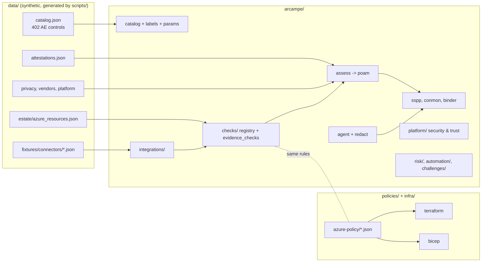

# Architecture

## Module cheat sheet

| Module | Job |
|---|---|
| `catalog.py`, `ids.py`, `labels.py`, `params.py` | Load controls, normalise IDs, label, hold CMS parameter values |
| `checks/registry.py` | 30 Azure checks (AZ-01..AZ-30) on the synthetic estate plus identity checks |
| `checks/evidence_checks.py` | 13 checks on connector evidence (patching, training, backups, scans) |
| `attest.py` | Attestation clock, due-soon / overdue / missing, draft reminders |
| `privacy.py`, `redact.py` | PT family: purposes, notices, consent, SSN rules, rights requests, DPIA |
| `supply_chain.py` | SR family: vendor tiers, scores, flow-down clauses |
| `assess.py`, `poam.py` | All findings in one list; failing ones become POA&M items |
| `sspp.py`, `conmon.py`, `binder.py` | Outputs |
| `crosswalk.py` | Author-built maps to 8 frameworks |
| `agent.py` | Drafter with human approval |
| `integrations/` | Connectors, OpenAPI, webhooks, no-code, mapper, evidence schema |
| `platform/` | Security & Trust: RBAC, tenancy, crypto, audit log, monitoring, backup, trust proofs |
| `risk/` | FAIR Monte Carlo, YAML risk modules, ERM, AI governance |
| `automation/` | Scheduler, evidence auditor |
| `challenges/` | Readiness score, scoring, response routing, visibility, business context, third party |
| `governance.py`, `incident.py`, `resilience.py`, `audit.py`, `internal_audit.py`, `regchange.py`, `custom.py` | Program areas |
| `iac.py` | Offline Azure Policy evaluator for parity with Python checks |

## Design rules
- One source of truth per fact: policy JSON feeds Terraform and Bicep; parameters live in `params.py`.
- Every generated file is deterministic so CI can diff it.
- Every claim in a doc is printed by a command (`render_docs.py --check`).
