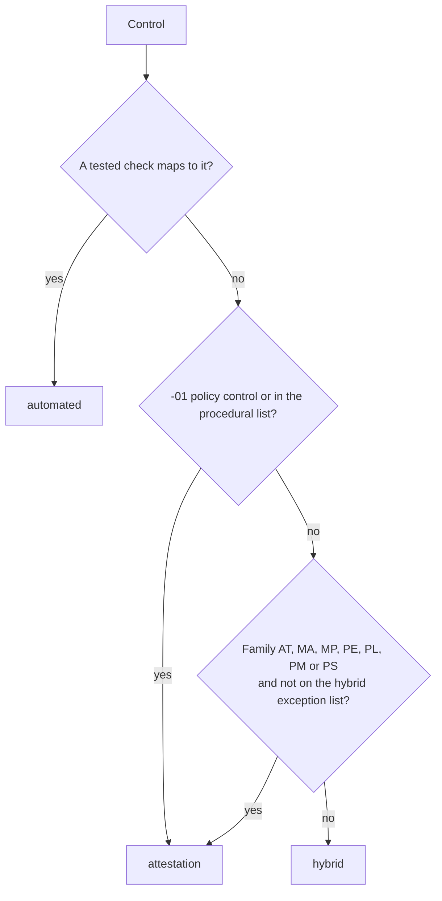

# Control catalog

## Sources
- **Control text and structure:** NIST SP 800-53 Rev 5 OSCAL catalog (public domain).
- **AE baseline (402 controls):** the public CMS ARC-AMPE Vol II SSPP workbook (ACA AE v1.02).
  This is the official list used here.
- **DEE baseline (308 controls):** a third-party parse, **not verified** against a CMS source. It is a
  strict subset of AE in this repo and is not used for any claim.

## Labels

<!-- run: python -m arcampe catalog -->
```text
| Family | Name | Controls | Automated | Hybrid | Attestation |
|---|---|---:|---:|---:|---:|
| AC | Access Control | 51 | 14 | 36 | 1 |
| AT | Awareness and Training | 9 | 0 | 2 | 7 |
| AU | Audit and Accountability | 19 | 9 | 9 | 1 |
| CA | Assessment, Authorization, and Monitoring | 12 | 1 | 7 | 4 |
| CM | Configuration Management | 31 | 6 | 24 | 1 |
| CP | Contingency Planning | 23 | 3 | 12 | 8 |
| IA | Identification and Authentication | 24 | 6 | 17 | 1 |
| IR | Incident Response | 16 | 1 | 8 | 7 |
| MA | Maintenance | 16 | 0 | 2 | 14 |
| MP | Media Protection | 9 | 0 | 1 | 8 |
| PE | Physical and Environmental Protection | 19 | 0 | 0 | 19 |
| PL | Planning | 6 | 0 | 1 | 5 |
| PM | Program Management | 28 | 0 | 2 | 26 |
| PS | Personnel Security | 9 | 1 | 1 | 7 |
| PT | Personally Identifiable Information Processing and Transparency | 10 | 0 | 7 | 3 |
| RA | Risk Assessment | 12 | 2 | 8 | 2 |
| SA | System and Services Acquisition | 34 | 2 | 21 | 11 |
| SC | System and Communications Protection | 34 | 13 | 20 | 1 |
| SI | System and Information Integrity | 34 | 6 | 27 | 1 |
| SR | Supply Chain Risk Management | 6 | 1 | 2 | 3 |
| **All** | 20 families | **402** | **65** | **207** | **130** |
```
<!-- /run -->



## Parameters
CMS organisation-defined values (lockout after 5 tries, 1-hour incident reporting, 15/30/90/365-day
remediation, US-only data locations and others) are restated in `arcampe/params.py` with the control
they come from. Check them against the workbook version you are assessed on.
