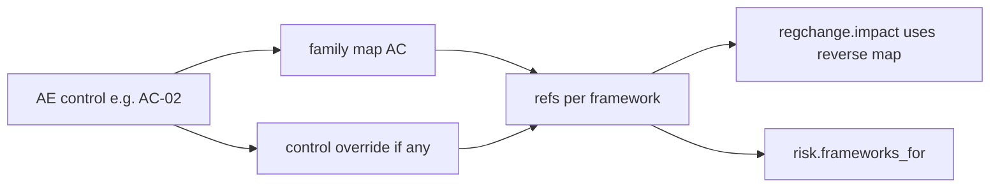

# Crosswalks

> Author-built, not official. Family-level maps with control-level overrides where the match is specific.
> Reference IDs only; no framework text is copied.

<!-- run-md: python -m arcampe.docs_tables crosswalks -->
| Framework | AE controls mapped | Distinct references |
|---|---:|---:|
| HIPAA | 402 | 27 |
| SOC2 | 402 | 27 |
| ISO27001 | 402 | 42 |
| PCI_DSS | 402 | 34 |
| GDPR | 242 | 16 |
| CCPA | 179 | 9 |
| COBIT | 402 | 21 |
| FEDRAMP_PROXY | 270 | 1 |
<!-- /run-md -->

| Framework | Reference style | Note |
|---|---|---|
| HIPAA | 45 CFR 164 Security Rule sections | Supports a covered entity's own analysis; not a BAA |
| SOC2 | 2017 Trust Services Criteria IDs | A SOC 2 Type II needs an independent CPA over a period |
| ISO27001 | ISO/IEC 27001:2022 Annex A IDs | Certification needs an accredited body |
| PCI_DSS | v4.0 principal requirements | Cardholder data is out of scope for this system |
| GDPR, CCPA | Articles / sections | Only privacy-relevant controls map |
| COBIT | 2019 objectives | Governance view |
| FEDRAMP_PROXY | "in NIST SP 800-53B Moderate" | 270 of 402 AE controls; not the FedRAMP Rev 5 baseline |

