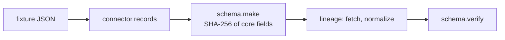

# How it works

## 1. Catalog and labels
The AE baseline (402 controls) is loaded from an OSCAL-shaped JSON file built from the NIST catalog and
the public CMS workbook. "Automated" is computed: a control is automated only if a tested check maps to it.

## 2. Evidence


<!-- run: python -m arcampe integrations -->
```text
153 evidence records, 153 hash-verified
```
<!-- /run -->

## 3. Checks and findings
<!-- run: python -m arcampe assess -->
```text
{
 "findings": 531,
 "passed": 428,
 "failed": 103,
 "by_source": {
  "attestation": {
   "passed": 104,
   "failed": 26
  },
  "azure": {
   "passed": 261,
   "failed": 47
  },
  "directory": {
   "passed": 5,
   "failed": 3
  },
  "evidence": {
   "passed": 20,
   "failed": 14
  },
  "privacy": {
   "passed": 27,
   "failed": 9
  },
  "vendor": {
   "passed": 11,
   "failed": 4
  }
 }
}
```
<!-- /run -->

## 4. POA&M
Failing findings get a stable ID (hash of check + resource), first-seen date from history, and a due date
from CMS SLA days: critical 15, high 30, moderate 90, low 365.

## 5. Attestations
<!-- run: python -m arcampe attest -->
```text
{"current": 90, "due_soon": 14, "overdue": 16, "missing": 10, "total": 130}
[draft, not sent] to=ciso cc=isso subject='[ARC-AMPE] 11 attestation(s) need your signature'
[draft, not sent] to=continuity-lead cc=None subject='[ARC-AMPE] 3 attestation(s) need your signature'
[draft, not sent] to=facilities-security cc=isso subject='[ARC-AMPE] 6 attestation(s) need your signature'
[draft, not sent] to=hr-security-liaison cc=isso subject='[ARC-AMPE] 1 attestation(s) need your signature'
[draft, not sent] to=ir-lead cc=None subject='[ARC-AMPE] 1 attestation(s) need your signature'
[draft, not sent] to=isso cc=isso subject='[ARC-AMPE] 6 attestation(s) need your signature'
[draft, not sent] to=it-ops-manager cc=isso subject='[ARC-AMPE] 4 attestation(s) need your signature'
[draft, not sent] to=procurement-lead cc=isso subject='[ARC-AMPE] 2 attestation(s) need your signature'
[draft, not sent] to=training-lead cc=isso subject='[ARC-AMPE] 6 attestation(s) need your signature'
```
<!-- /run -->

## 6. Statements and the SSPP
The drafter writes from catalog text, parameters and check results. Only 12 statements are approved
(by the fictional ISSO r.alvarez) in `data/approvals.json`; every other row says "Pending approval".

## 7. CONMON and binder
The binder zip holds the SSPP, POA&M, CONMON, evidence, attestations, risk top 10, trust results and the
responsibility CSV, with a SHA-256 manifest. Building twice gives identical bytes.

## 8. Scheduler (30 simulated days)
<!-- run: python -m arcampe schedule -->
```text
{"run_config_checks": 30, "refresh_stale_evidence": 30, "poam_sla_alerts": 30, "monthly_conmon_report": 1, "vulnerability_scan_window": 1, "weekly_log_review_reminder": 4, "attestation_reminders": 4}
```
<!-- /run -->
