# Implementation guide (for adopters)

```mermaid
flowchart LR
  S1[1. Fork, run tests] --> S2[2. Replace params.py with your workbook values]
  S2 --> S3[3. Export your estate as Resource Graph JSON]
  S3 --> S4[4. Write real connectors behind BaseConnector]
  S4 --> S5[5. Load your attestations]
  S5 --> S6[6. Review labels with your ISSO]
  S6 --> S7[7. Apply Azure Policy in Audit mode]
  S7 --> S8[8. Add a model backend, keep human approval]
```

1. **Check the baseline.** Confirm the AE workbook version. If you are a DEE, get the DEE baseline from CMS.
2. **Parameters.** Edit `arcampe/params.py`; tests that use parameters will show what changes.
3. **Estate.** Replace `data/estate/azure_resources.json` with an Azure Resource Graph export (same keys).
4. **Connectors.** Subclass `BaseConnector`, keep scopes read-only, keep fixtures for tests. Or describe
   a REST API with an OpenAPI spec and an `x-arcampe` block.
5. **Attestations.** Load owners and dates into `data/attestations.json`. Wire reminders to your mail
   system only after review; they are drafts by default.
6. **Labels.** Walk the hybrid and attestation lists with your ISSO; edit `labels.py`.
7. **Policy.** `terraform plan` with `effect = "Audit"` first; move to `Deny` one rule at a time.
8. **AI.** Add a Microsoft Foundry backend behind `complete(ctx)` over a private endpoint. Keep the
   stub in CI. Do not remove the approval rules.
9. **Evidence for assessors.** Ship `out/ato_binder.zip`; assessors re-run `binder.verify()`.
