# 00. Start here

**What you'll learn:** what this repo is, the order to read it in, and the three commands that show it working.

**Read this after:** nothing; this is the first page

This repo is a compliance automation project for a fictional state health exchange, **Lakehaven Health
Connector** (`lakehaven-hx.example`). It turns the CMS ARC-AMPE control baseline (402 controls, based on NIST
SP 800-53 Rev 5) into code: checks, evidence, a POA&M (the list of open fixes), an ATO binder and, in the GRC
extension, workspaces per business unit, workflows, risk registers, an auditor area, an MCP-style server for AI
agents, AI governance, and daily and weekly leadership reports.

**Everything is synthetic.** Every number in these pages is printed by a real run of the code on synthetic
data and re-checked in CI. Numbers marked **SIMULATED** come from stated assumptions, not from measurement.

## Reading order

| # | Page | One line |
|---:|---|---|
| 00 | [Start Here](00_START_HERE.md) | Map of the docs |
| 01 | [The Problem](01_THE_PROBLEM.md) | Why compliance work is slow and error-prone |
| 02 | [Concepts](02_CONCEPTS.md) | Controls, evidence, POA&M, readiness |
| 03 | [Architecture](03_ARCHITECTURE.md) | Modules and data flow |
| 04 | [Agents](04_AGENTS.md) | Every AI agent, what it may do, who approves |
| 05 | [Workflows](05_WORKFLOWS.md) | Event-driven workflows and reviews |
| 06 | [Frameworks And Readiness](06_FRAMEWORKS_AND_READINESS.md) | 34 frameworks and readiness rings |
| 07 | [Ai Governance](07_AI_GOVERNANCE.md) | Shadow AI, decision rights, decision records, replay |
| 08 | [Identity Resilience](08_IDENTITY_RESILIENCE.md) | Identity as the first recovery dependency |
| 09 | [Executive Reporting](09_EXECUTIVE_REPORTING.md) | Daily and weekly leadership emails (previews only) |
| 10 | [Use Cases](10_USE_CASES.md) | Fifteen end-to-end stories |
| 11 | [How To Run](11_HOW_TO_RUN.md) | Commands |
| 12 | [Results](12_RESULTS.md) | Measured numbers |
| 13 | [Limitations](13_LIMITATIONS.md) | What this is not |
| 14 | [GRC operations](14_GRC_OPERATIONS.md) | Readiness sign-off, recipes, insights, scorecards, AI tests, audit hub |

After the sequence, read [PRESENTATION_GUIDE.md](../../PRESENTATION_GUIDE.md) to present the project.

## See it work in three commands

```bash
pip install -r requirements-dev.txt
python -m pytest -q                       # all tests, offline
python -m arcampe.grc all --out out       # every GRC output, including report previews (never sent)
```

```mermaid
flowchart LR
  P[01 Problem] --> C[02 Concepts] --> A[03 Architecture] --> AG[04 Agents] --> W[05 Workflows]
  W --> F[06 Frameworks] --> AI[07 AI governance] --> ID[08 Identity] --> R[09 Reports]
  R --> U[10 Use cases] --> H[11 How to run] --> RS[12 Results] --> L[13 Limitations]
```



---

**Next:** [01_THE_PROBLEM](01_THE_PROBLEM.md)
