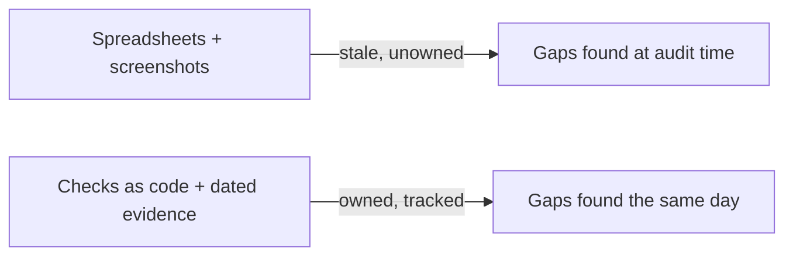

# 01. The problem

**What you'll learn:** why yearly compliance work for a health exchange is slow, and what goes wrong.

**Read this after:** [00_START_HERE](00_START_HERE.md)

A state health exchange (an "Administering Entity") must show CMS that it meets the ARC-AMPE baseline every year.
In most teams this means spreadsheets, screenshots and email chains:

- **Evidence goes stale.** A screenshot from March says nothing about October.
- **Nobody owns the gap.** A failing control sits in a list with no owner and no due date.
- **Frameworks multiply.** The same MFA control is asked about by SOC 2, HIPAA, ISO 27001 and a dozen
  questionnaires, each in its own words.
- **Edits break trust.** A control marked "compliant" is changed later and nobody re-reviews it.
- **AI adds new risk.** Teams now use AI tools, some unapproved, and AI agents start to act. Leaders must be able
  to say what an agent decided, on what input, and who approved it.
- **Leaders get activity, not status.** A weekly email lists tasks, not readiness, trend or risk.

This repo shows one way to make the work continuous: checks run as code, evidence carries its own date and hash,
every failure becomes a tracked item with an owner and a deadline, and leadership gets a short report built from
the same data.

---

**Next:** [02_CONCEPTS](02_CONCEPTS.md)
