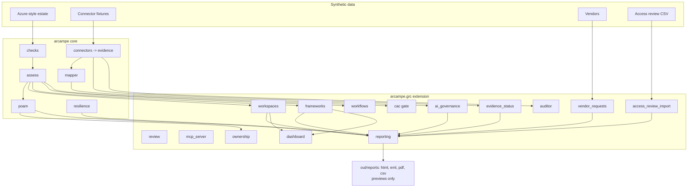

# 03. Architecture

**What you'll learn:** which module does what and how data flows from the synthetic estate to the leadership report.

**Read this after:** [02_CONCEPTS](02_CONCEPTS.md)

**Design rules**

1. **Core outputs do not drift.** The GRC extension lives in `arcampe/grc/` and only reads the core. The one
   deliberate core change is in `arcampe/resilience.py`: identity is now the first dependency of every
   business-critical service.
2. **Deterministic.** Same input, same bytes: fixed zip timestamps, fixed MIME boundaries, fixed dates.
3. **No network code.** The report `send()` function needs a config, an approval flag and a transport, and the
   repo ships no transport.
4. **People approve.** Agents propose; named people with the right role approve, and nobody approves their own work.

---

**Next:** [04_AGENTS](04_AGENTS.md)
