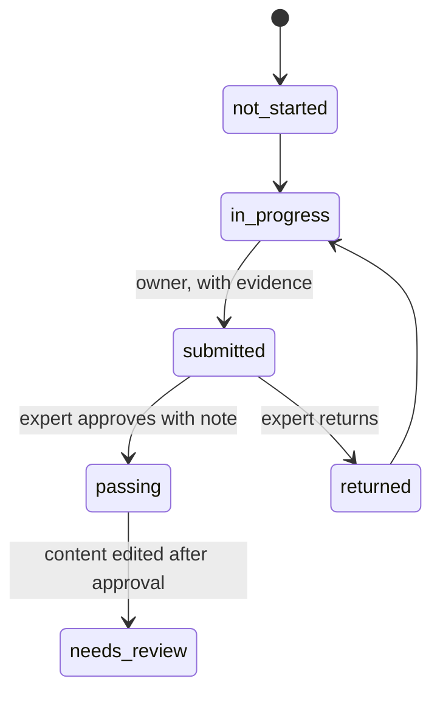

# 05. Workflows

**What you'll learn:** how events become actions, how reviews work, and how a pipeline gate stops a bad change.

**Read this after:** [04_AGENTS](04_AGENTS.md)

## Event-driven workflows (simulated)

Every failing finding is an event. Workflows match conditions and produce actions (ticket, chat message,
webhook). Actions are **logged, never sent**.

<!-- run: python -m arcampe.grc workflows --out out -->
```text
{"events": 103, "actions": 129, "by_action": {"ticket": 43, "slack": 43, "webhook": 43}, "sent": 0}
```
<!-- /run -->

## Expert review per control



<!-- run: python -m arcampe.grc review --out out -->
```text
{"board": {"not_started": 0, "in_progress": 1, "submitted": 1, "passing": 5, "returned": 2, "needs_review": 1}, "drift": [{"control": "AU-06", "owner": "owner-2", "approved_hash": "02b84a4b6bd2", "current_hash": "ea9cd6c381ba"}]}
```
<!-- /run -->

## Compliance as code: pipeline gate

The gate compares the PR's findings with the main branch and blocks only **new** failures at or above high.

<!-- run: python -m arcampe.grc cac --out out -->
```text
{"suggestions": 47, "gate": {"result": "fail", "new_failures": 1, "blocking": 1, "fixed": 1, "blocking_ids": ["AZ-13:nsg-lhx-new"], "override": "security lead, with a written reason (logged)"}}
```
<!-- /run -->

## Evidence freshness, owners and escalation

<!-- run: python -m arcampe.grc evidence --out out -->
```text
{"counts": {"Needs Artifact": 0, "Needs Renewal": 24, "Upcoming Renewal": 11, "Ready": 118, "Error": 0}, "fresh_pct": 84.3}
```
<!-- /run -->

<!-- run: python -m arcampe.grc owners --out out -->
```text
{"owner": 6, "manager": 2, "ciso": 14}
```
<!-- /run -->

## Scanner evidence for RA-5 and SI-2

A Nessus-style CSV or XML export (synthetic, CVE-2099-* IDs) becomes `vuln_scan` evidence per host (RA-05, plus
RA-05(05) when credentialed) and `flaw_remediation` evidence per open finding (SI-02) with an SLA due date.
Free text with injection-like content is quarantined; XML with a DOCTYPE is refused.

<!-- run: python -m arcampe.grc scanner --out out -->
```text
SCAN-COVERAGE      RA-05     FAIL  5/7 hosts scanned in 30 days; never scanned ['vm-lhx-reporting-01']; stale ['vm-lhx-jump-01']
SCAN-CREDENTIALED  RA-05(05) FAIL  83.3% of scanned hosts used credentials
SCAN-SLA           SI-02     FAIL  8 of 11 open findings past SLA
SCAN-KEV           SI-02     FAIL  4 known-exploited findings past SLA
SCAN-SCREEN        SI-10     PASS  1 rows had injection-like text and were quarantined
{"open": 11, "by_severity": {"critical": 1, "high": 5, "moderate": 3, "low": 2}, "overdue": 8, "kev_open": 4, "coverage_pct": 71.4, "credentialed_pct": 83.3, "never_scanned": 1}
```
<!-- /run -->

## Vendor requests and access reviews

<!-- run: python -m arcampe.grc vendors --out out -->
```text
{"id": "VR-101", "vendor": "Fernhollow Survey Tools", "state": "approved", "tier": "high", "age": 11, "sla": 15, "breached": false, "score": 30, "band": "low"}
{"id": "VR-102", "vendor": "Quarrystone Translation", "state": "questionnaire_sent", "tier": "critical", "age": 29, "sla": 10, "breached": true}
{"id": "VR-103", "vendor": "Ashgrove Chat Widgets", "state": "rejected", "tier": "high", "age": 19, "sla": 15, "breached": false, "score": 50, "band": "moderate"}
```
<!-- /run -->

<!-- run: python -m arcampe.grc access-review --out out -->
```text
{"campaign": "Q3-2026 user access review", "rows": 48, "reviewed": 47, "complete_pct": 97.9, "decisions": {"keep": 39, "modify": 4, "revoke": 4}, "late": true, "issues": {"pending": 1, "self_review": 1, "terminated_not_revoked": 2, "stale_admin_kept": 5}}
```
<!-- /run -->

---

**Next:** [06_FRAMEWORKS_AND_READINESS](06_FRAMEWORKS_AND_READINESS.md)
