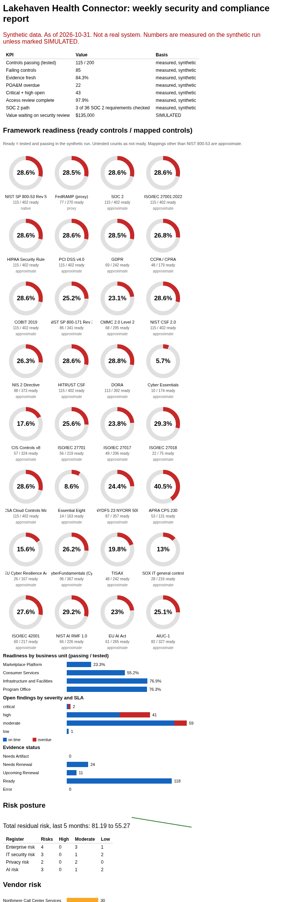

# 06. Frameworks and readiness

**What you'll learn:** which 34 frameworks are mapped, how approximate each mapping is, and how readiness rings are computed.

**Read this after:** [05_WORKFLOWS](05_WORKFLOWS.md)

Readiness = controls that **passed a test** divided by controls mapped to the framework. Untested controls are not
ready. Numbers come from the synthetic run, never from a vendor screenshot.

Coverage labels: **native** (the baseline itself), **proxy** (FedRAMP Moderate-style proxy), **approximate**
(author-built mapping, family level, needs expert review before any real use), **covered** (custom framework),
**gap** (no mapping yet).

<!-- run: python -m arcampe.grc frameworks --out out -->
```text
| Framework | Ready / mapped | Ready % | Failing | Untested |
|---|---:|---:|---:|---:|
| NIST SP 800-53 Rev 5 | 115 / 402 | 28.6% | 85 | 202 |
| FedRAMP (proxy) | 77 / 270 | 28.5% | 66 | 127 |
| SOC 2 | 115 / 402 | 28.6% | 85 | 202 |
| ISO/IEC 27001:2022 | 115 / 402 | 28.6% | 85 | 202 |
| HIPAA Security Rule | 115 / 402 | 28.6% | 85 | 202 |
| PCI DSS v4.0 | 115 / 402 | 28.6% | 85 | 202 |
| GDPR | 69 / 242 | 28.5% | 52 | 121 |
| CCPA / CPRA | 48 / 179 | 26.8% | 39 | 92 |
| COBIT 2019 | 115 / 402 | 28.6% | 85 | 202 |
| NIST SP 800-171 Rev 3 | 86 / 341 | 25.2% | 71 | 184 |
| CMMC 2.0 Level 2 | 68 / 295 | 23.1% | 66 | 161 |
| NIST CSF 2.0 | 115 / 402 | 28.6% | 85 | 202 |
| NIS 2 Directive | 98 / 373 | 26.3% | 77 | 198 |
| HITRUST CSF | 115 / 402 | 28.6% | 85 | 202 |
| DORA | 113 / 392 | 28.8% | 81 | 198 |
| Cyber Essentials | 10 / 174 | 5.7% | 40 | 124 |
| CIS Controls v8 | 57 / 324 | 17.6% | 71 | 196 |
| ISO/IEC 27701 | 56 / 219 | 25.6% | 53 | 110 |
| ISO/IEC 27017 | 49 / 206 | 23.8% | 44 | 113 |
| ISO/IEC 27018 | 22 / 75 | 29.3% | 19 | 34 |
| CSA Cloud Controls Matrix v4 | 115 / 402 | 28.6% | 85 | 202 |
| Essential Eight | 14 / 163 | 8.6% | 33 | 116 |
| NYDFS 23 NYCRR 500 | 87 / 357 | 24.4% | 74 | 196 |
| APRA CPS 230 | 53 / 131 | 40.5% | 20 | 58 |
| EU Cyber Resilience Act | 26 / 167 | 15.6% | 33 | 108 |
| CyberFundamentals (CyFun) | 96 / 367 | 26.2% | 76 | 195 |
| TISAX | 48 / 242 | 19.8% | 61 | 133 |
| SOX IT general controls | 28 / 216 | 13.0% | 42 | 146 |
| ISO/IEC 42001 | 60 / 217 | 27.6% | 44 | 113 |
| NIST AI RMF 1.0 | 66 / 226 | 29.2% | 46 | 114 |
| EU AI Act | 61 / 265 | 23.0% | 60 | 144 |
| AIUC-1 | 82 / 327 | 25.1% | 70 | 175 |
```
<!-- /run -->

The Trust Dashboard (`out/grc/dashboard.html`) and the weekly report show these as rings: green at 80% or more,
amber at 50% or more, red below.



## Industry packs and multi-org mode

Industry packs bundle frameworks a regulated industry is asked about: **banking and credit unions** (FFIEC CAT /
NCUA ACET, NYDFS Part 500, SEC Regulation S-P), **defense** (CMMC 2.0 Level 2, NIST SP 800-171), **legal** (ABA
Model Rule 1.6 with Formal Opinions 477R and 483), **broker-dealers and advisers** (SEC Regulation S-P, SOX ITGC)
and the **health exchange** itself. All pack mappings are approximate.

Multi-org mode runs five fictional organisations from one install. Each service key is scoped to one org; any
cross-org read raises an error and is written to a hash-chained audit log. The cross-org portfolio shows counts only.

<!-- run: python -m arcampe.grc industry-packs --out out -->
```text
health_exchange        NIST SP 800-53 Rev 5                      28.6%  (115/402, approximate)
health_exchange        HIPAA Security Rule                       28.6%  (115/402, approximate)
banking_credit_union   FFIEC CAT / NCUA ACET                     28.8%  (113/392, approximate)
banking_credit_union   NYDFS 23 NYCRR 500                        24.4%  (87/357, approximate)
banking_credit_union   SEC Regulation S-P (2024 amendments)      25.2%  (71/282, approximate)
defense                CMMC 2.0 Level 2                          23.1%  (68/295, approximate)
defense                NIST SP 800-171 Rev 3                     25.2%  (86/341, approximate)
legal                  ABA Model Rule 1.6 (with Op. 477R, 483)   20.5%  (52/254, approximate)
broker_dealer_adviser  SEC Regulation S-P (2024 amendments)      25.2%  (71/282, approximate)
broker_dealer_adviser  SOX IT general controls                   13.0%  (28/216, approximate)
org lakehaven   health_exchange        passing/tested 115/200 = 57.5%
org cedarbrook  banking_credit_union   passing/tested 199/286 = 69.6%
org ironvale    defense                passing/tested 190/262 = 72.5%
org marlow      legal                  passing/tested 195/277 = 70.4%
org northgate   broker_dealer_adviser  passing/tested 169/252 = 67.1%
```
<!-- /run -->

The list of frameworks follows a public framework catalog read on 2026-10-31 (see
[SOURCE_COVERAGE](../SOURCE_COVERAGE.md)). No affiliation; no vendor numbers are reused.

---

**Next:** [07_AI_GOVERNANCE](07_AI_GOVERNANCE.md)
