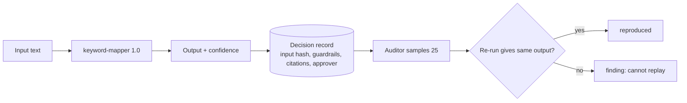

# 07. AI governance and accountability

**What you'll learn:** how the repo governs AI: approved model and app register, shadow AI, decision rights, AI decision records, replay audits and the 12 leadership KPIs.

**Read this after:** [06_FRAMEWORKS_AND_READINESS](06_FRAMEWORKS_AND_READINESS.md)

## Why this matters (context only)

Leaders worry about staff using AI without approval, legal exposure from AI agents, depending on too few AI
vendors, and not being able to monitor their agents in real time. Each KPI below answers one of those worries.

## The controls and their decision rights

| Control | Proposes | Approves | Escalates to | When |
|---|---|---|---|---|
| AI-DEV-EVAL | ml-lead | ciso | ai-governance-board | a safety metric is below target at release |
| AI-SHADOW | agent:discovery | it-ops-manager | ciso | unapproved tool handles PII or is untriaged after 10 days |
| AI-DECISION-RECORD | agent:evidence-mapper | isso | ciso | a sampled decision cannot be replayed |
| AI-AGENT-OVERSIGHT | agent:coordinator | isso | ciso | missed heartbeats for 24h or override above 20% |
| AI-VENDOR | agent:tprm | procurement-lead | *(missing)* | *(missing)*: a deliberate gap, so coverage is 80% |

## Approved AI model and app register

Every AI model or app in use must point at a register entry (ISO/IEC 42001 Annex A.6, NIST AI RMF GOVERN 1.6 and
MAP) that is approved or conditional, inside its allowed data classes and tools, and evaluated in the last 180
days. Anything else is a finding.

## AI decision records and replay

Each agent decision is stored as evidence of kind `ai_decision_record`: the input (and its hash), model and version,
guardrails, citations, approver and outcome. An auditor samples 25 records with a fixed seed and **re-runs each
one** with the same deterministic model. One record was altered on purpose, and the replay catches it.



## The 12 KPIs (real output)

<!-- run: python -m arcampe.grc ai-governance --out out -->
```text
Agent decision explainability rate: 96.7% [measured, synthetic]
Decision-audit pass rate: 96.0% (24/25 replayed) [measured, synthetic]
Agent monitoring coverage: 83.3% (5/6) [measured, synthetic]
Human-approval SLA and override rate: median 9.0h; 11.7% edited [measured, synthetic]
Autonomy level mix: suggest_only 5, act_with_approval 1, act_then_notify 0 [configuration]
AI decision-rights coverage: 80.0% [configuration]
Shadow AI exposure: 4 unapproved tools; 25.0% triaged within SLA [measured, synthetic]
AI vendor concentration index: top-1 60.0%, top-2 80.0%, fallback 60.0% [measured, synthetic]
AI regulatory readiness (approximate): ISO/IEC 42001 27.6%; NIST AI RMF 1.0 29.2%; EU AI Act 23.0% [measured, synthetic]
Agent legal-risk incidents blocked: 6 blocked (critical 3, high 2, moderate 1) [measured, scripted attempts]
AI program ROI: 5.8 analyst hours saved; $493 at $85/h; $0.04/run [SIMULATED]
AI provider outage drill: 2026-08-20: partial (Provider A unavailable for 8 hours) [synthetic]
register: {"entries": 5, "by_status": {"approved": 3, "conditional": 1, "retired": 1}, "uses": 7, "uses_compliant": 3, "inventory_coverage_pct": 83.3}
```
<!-- /run -->

ROI is **SIMULATED**: 6 minutes saved per auto-mapped item at $85 per hour, stated in `ai_governance.py`.
Legal-risk incidents come from a fixed script of risky attempts sent through the MCP server; every blocked
attempt is counted by severity.

---

**Next:** [08_IDENTITY_RESILIENCE](08_IDENTITY_RESILIENCE.md)
