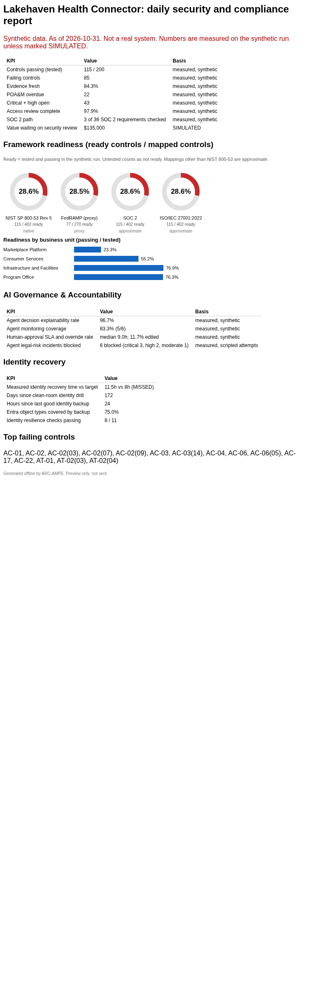
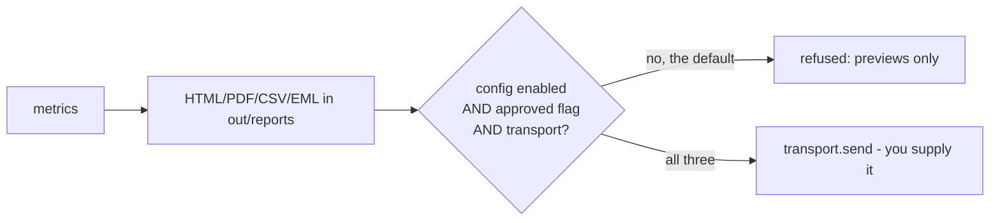

# 09. Executive reporting

**What you'll learn:** what the daily and weekly leadership emails contain, how they are built, scheduled and (only with approval) sent.

**Read this after:** [08_IDENTITY_RESILIENCE](08_IDENTITY_RESILIENCE.md)

## What is in each report

| Section | Daily | Weekly |
|---|:-:|:-:|
| Headline KPIs (readiness, failing controls, freshness, POA&M overdue, critical+high, access review, SOC 2 path, trust-to-revenue SIMULATED) | yes | yes |
| Framework readiness rings | top frameworks | all 34 |
| Readiness by business unit | yes | yes |
| Findings by severity and SLA, evidence status | yes | yes |
| Risk posture and trend, vendor risk, agent KPIs, questionnaire turnaround | | yes |
| AI Governance & Accountability | compact tile (daily KPIs) | all 12 KPIs + model register |
| Identity recovery | yes | yes |
| Vulnerability scanning evidence (RA-5, SI-2) | yes | yes |
| Industry packs (approximate) | | yes |

## Outputs

<!-- run: python -m arcampe.grc report --out out --kind weekly -->
```text
wrote preview (not sent): out/reports/weekly.csv
wrote preview (not sent): out/reports/weekly.eml
wrote preview (not sent): out/reports/weekly.html
wrote preview (not sent): out/reports/weekly.pdf
```
<!-- /run -->

Each run writes HTML (inline SVG charts, no external images), a `.eml` preview with the subject
`[PREVIEW - NOT SENT]`, a PDF and a CSV.



## Sending is off by default



`send()` refuses unless a config is enabled with an allowed recipient domain and no secrets in the file, the
`approved=True` flag is set, and a transport object is passed in. The repo ships no transport.

## Scheduling

<!-- run: python -m arcampe.grc schedule --out out -->
```text
# ARC-AMPE leadership reports (previews only unless sending is configured and approved)
CRON_TZ=America/New_York
0 7 * * 1-5 cd /opt/arc-ampe && python -m arcampe.grc report --kind daily --out out
0 7 * * 1 cd /opt/arc-ampe && python -m arcampe.grc report --kind weekly --out out
```
<!-- /run -->

- **cron:** the lines above (weekdays 07:00 America/New_York for daily, Mondays for weekly).
- **GitHub Actions:** [examples/reporting/leadership-report.yml](../../examples/reporting/leadership-report.yml)
  builds previews and uploads them as an artifact. It is an example and is not in `.github/workflows`.
- **Microsoft Foundry, Logic Apps, SendGrid:** see [examples/reporting/DEPLOY.md](../../examples/reporting/DEPLOY.md).

---

**Next:** [10_USE_CASES](10_USE_CASES.md)
