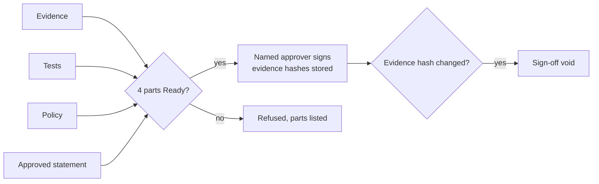

# 14. GRC operations: readiness sign-off, recipes, insights, scorecards

**What you'll learn:** the operating features in the GRC extension: control readiness
approval, ten workflow recipes, pass-to-fail insights and MTTR, policy approval tiers, risk SLAs and loss ranges,
AI-drafted tests, a mapping eval harness, an audit hub, AI framework views with EU CRA clocks, a "which framework
next" helper, recurring reviews, new read-only MCP tools and three leadership scorecards.

**Read this after:** [13_LIMITATIONS](13_LIMITATIONS.md)

Every step that changes something still needs a named person. Where a figure matters (for example, how much of
ISO 42001 a SOC 2 program already covers), this repo measures or states its own value with its inputs.



| Piece | Module | Human gate |
|---|---|---|
| A1 Control readiness approval (evidence, tests, policies, approvals) | `grc/readiness_approval.py` | ISSO, CISO or control approver signs; agents refused |
| A2 Ten workflow recipes, one trigger each | `grc/recipes.py` | Delivery needs `deliver=True` and a named approver; nothing is sent |
| A3 Notification lifecycle and Monday digest | `grc/recipes.py` | Digest is a file |
| A4 Pass-to-fail flips (24h, 7d, 14d) and MTTR | `grc/insights.py` | none (read only) |
| A5 Policy approval tiers (1 to 6; all, any, k-of-n) and version diff | `grc/policy_approvals.py` | Every tier is people; the change summary is labeled and never counts as approval |
| A6 Register owners, moves with history, roll-up | `grc/risk_program.py` | Only a register owner can move a risk |
| A7 FAIR-style loss ranges per register | `grc/risk_program.py` | CRO signs the appetite before "within/above" is shown |
| A8 Risk SLAs (identify, remediate, accept) | `grc/risk_program.py` | Acceptances need an owner and a future expiry |
| A9 AI-drafted control tests | `grc/ai_tests.py` | Auditor or engineer approves before a test goes live |
| A10 Control-mapping eval harness | `grc/mapping_eval.py` | none (measurement) |
| A11 Audit hub: requests, pre-audit package, internal audits, hash-chained evidence | `grc/audit_hub.py` | Independence rule; low-confidence mappings need a person |
| A12 ISO 42001, NIST AI RMF, EU AI Act, AIUC-1, EU CRA clocks | `grc/ai_frameworks.py` | CRA submissions need a named approver |
| A13 Which framework next | `grc/roadmap.py` | Output is a suggestion only |
| A14 Recurring reviews | `grc/recurring.py` | A named person completes each one |
| A15 MCP read tools: exec risk summary, prioritized failures, mapping summary | `grc/mcp_server.py` | Write tools still need approval |
| Scorecards | `grc/scorecards.py` | none (report) |

## Readiness sign-off

<!-- run: python -m arcampe.grc readiness-approval -->
```text
{"controls": 402, "ready_by_part": {"evidence": 46, "tests": 115, "policies": 272, "approvals": 12}, "all_four_ready": 1}
```
<!-- /run -->

Only one control has all four parts Ready in the synthetic data. That is honest: most controls lack an approved
control statement, which is the part a person writes.

## Recipes and digest

<!-- run: python -m arcampe.grc recipes --out out -->
```text
{"events": 94, "actions": 82, "by_recipe": {"R01": 11, "R02": 19, "R03": 1, "R04": 43, "R05": 2, "R06": 2, "R07": 1, "R08": 1, "R09": 1, "R10": 1}, "sent": 0}
wrote out/grc/monday_digest.txt (2479 bytes)
```
<!-- /run -->

## Insights and MTTR

<!-- run: python -m arcampe.grc insights -->
```text
{"tests": 531, "failing_now": 103, "flipped": {"24h": 2, "7d": 22, "14d": 41}, "flipped_7d_by_family": {"AC": 1, "AT": 1, "AU": 2, "CM": 2, "CP": 4, "IA": 2, "MA": 1, "PM": 2, "PS": 1, "SA": 2, "SI": 2, "SR": 2}, "mttr_hours": 86.1, "fixes_in_window": 104, "label": "synthetic history"}
```
<!-- /run -->

The 30-day history is synthetic but deterministic: today matches the real assessment run; earlier days are derived
with a seeded rule.

## Risk loss ranges and SLAs

<!-- run: python -m arcampe.grc risk-program -->
```text
RR-AI   P50 $         0  P90 $   969,730  P95 $ 1,662,061  (SIMULATED)
RR-ENT  P50 $   124,541  P90 $ 4,397,273  P95 $ 6,732,892  (SIMULATED)
RR-PRV  P50 $   287,284  P90 $ 1,280,319  P95 $ 1,803,977  (SIMULATED)
RR-SEC  P50 $         0  P90 $ 6,678,826  P95 $ 9,185,081  (SIMULATED)
{"adherence_pct": 81.2, "breaches": 3, "invalid_acceptances": ["RR-ENT-07"]}
```
<!-- /run -->

The board view uses ranges, not colors. A P50 of $0 means most simulated years have no loss event for that
register; the tail (P90, P95) is the point.

## AI-drafted tests and the mapping eval

<!-- run: python -m arcampe.grc ai-tests -->
```text
{"requests": 10, "invalid_after_retries": 1, "duplicates": 2, "reviewed": 7, "live": 6, "rejected": 1, "edited_before_approval": 1, "acceptance_pct": 85.7, "first_try_valid": 4, "label": "measured on synthetic requests"}
```
<!-- /run -->

<!-- run: python -m arcampe.grc mapping-eval -->
```text
exact       top1=0.983 top3=0.983 mrr=0.983 missed=1
paraphrase  top1=0.9 top3=0.9 mrr=0.9 missed=6
partial     top1=0.883 top3=0.883 mrr=0.883 missed=7
keyword     top1=0.4 top3=0.4 mrr=0.4 missed=36
```
<!-- /run -->

Keyword-only queries score far lower than full sentences. That is the measured weakness of a keyword mapper and why
low-confidence items go to a person.

## Audit hub and AI frameworks

<!-- run: python -m arcampe.grc audit-hub -->
```text
{"requests": 12, "auto_mapped": 9, "mapped_correctly": 9, "ready": 7, "label": "measured on synthetic requests"}
[{"audit": "IA-Q1", "family": "AC", "auditor": "riya.ia", "independent": true}, {"audit": "IA-Q2", "family": "CM", "auditor": "omar.ia", "independent": true}, {"audit": "IA-Q3", "family": "CP", "auditor": "omar.ia", "independent": true}, {"audit": "IA-Q4", "family": "AT", "auditor": "riya.ia", "independent": false}]
```
<!-- /run -->

<!-- run: python -m arcampe.grc ai-frameworks -->
```text
ISO/IEC 42001    60/217 ready (27.6%, approximate)
NIST AI RMF 1.0  66/226 ready (29.2%, approximate)
EU AI Act        61/265 ready (23.0%, approximate)
AIUC-1           82/327 ready (25.1%, approximate)
56.0 % ISO 42001 topic overlap (author judgement)
{"events": 3, "met": 6, "late": 1, "overdue": 1, "label": "synthetic events"}
```
<!-- /run -->

EU CRA clocks used here: early warning within 24 hours, notification within 72 hours, and a final report within
14 days after a fix is available (one month for a severe incident). Check the regulation text before relying on it.

## Which framework next, and recurring reviews

<!-- run: python -m arcampe.grc roadmap -->
```text
defense [('NIST_800_171', 130.1), ('CMMC_L2', 129.2), ('FEDRAMP_PROXY', 101.4)]
health [('HIPAA', 131.4), ('HITRUST', 131.4), ('ISO27001', 71.4)]
regulated_eu [('ISO27001', 131.4), ('NIS2', 130.5), ('DORA', 101.5)]
ai_vendor [('ISO42001', 131.0), ('AIUC_1', 130.0), ('NIST_AI_RMF', 101.7)]
```
<!-- /run -->

<!-- run: python -m arcampe.grc recurring -->
```text
RT-01 weekly      done 6/8 missed 2 next 2026-11-02  Weekly control review
RT-02 bi-monthly  done 2/4 missed 1 next 2026-12-31  Vendor reassessment
RT-03 semi-annual done 1/2 missed 1 next 2027-01-14  AI policy review
RT-04 quarterly   done 3/3 missed 0 next 2026-11-01  Firewall rule review
RT-05 monthly     done 5/6 missed 1 next 2026-11-28  Privileged access review
```
<!-- /run -->

## Scorecards

<!-- run: python -m arcampe.grc scorecards -->
```text
[efficiency]
  Audit prep hours per cycle: baseline (2025 cycle): 120 -> current (2026 cycle): 74 [SIMULATED]
  Evidence automation rate: 86.9% (133 / 153) [measured, synthetic]
  Auditor requests (PBC) this cycle: 12 (7 ready) [measured, synthetic]
  Audit findings trend: 2025: 14 -> 2026 H1: 11 -> 2026 H2: 9 [SIMULATED]
  MTTR for failed tests: 86.1 h [measured on synthetic history]
  Tests flipped pass->fail in 24h / 7d / 14d: 2 / 22 / 41 [measured on synthetic history]
  Recurring reviews on time: 78.3% [measured, synthetic]
[risk]
  Open high residual risks: 0 [measured, synthetic]
  Critical + high findings open: 43 [measured, synthetic]
  Control effectiveness (passing / tested): 57.5% [measured, synthetic]
  Risk SLA adherence: 81.2% (3 breaches) [measured, synthetic]
  Invalid risk acceptances (no owner or expired): 1 [measured, synthetic]
  AI inventory coverage: 83.3% [measured, synthetic]
  Risky AI actions blocked: 6 blocked (critical 3, high 2, moderate 1) [measured, synthetic]
  FAIR annual loss RR-AI (P50 / P90 / P95): $0 / $969,730 / $1,662,061 [SIMULATED (FAIR-style Monte Carlo)]
  FAIR annual loss RR-ENT (P50 / P90 / P95): $124,541 / $4,397,273 / $6,732,892 [SIMULATED (FAIR-style Monte Carlo)]
  FAIR annual loss RR-PRV (P50 / P90 / P95): $287,284 / $1,280,319 / $1,803,977 [SIMULATED (FAIR-style Monte Carlo)]
  FAIR annual loss RR-SEC (P50 / P90 / P95): $0 / $6,678,826 / $9,185,081 [SIMULATED (FAIR-style Monte Carlo)]
[trust]
  Questionnaire turnaround: 15.0 days avg vs 5-day target [measured, synthetic]
  Questionnaire SLA breaches: 1 [measured, synthetic]
  AI evidence-mapping precision: 0.983 [measured on labeled set]
  AI-generated tests accepted by reviewers: 85.7% (6 live) [measured on synthetic requests]
  EU CRA reporting clocks met: 6 of 8 [measured, synthetic events]
  Value waiting on security review: $135,000 [SIMULATED]
```
<!-- /run -->

---

**Next:** [PRESENTATION_GUIDE.md](../../PRESENTATION_GUIDE.md)
