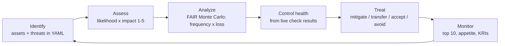

# Cyber risk lifecycle and FAQ

> All dollar values and frequencies in `data/risk/modules/cyber.yaml` are **synthetic inputs**.
> The simulation is seeded (20261031, 10,000 years per scenario) so results repeat exactly.

## Lifecycle

## Top 10 (live run, findings included)

<!-- run-md: python -m arcampe.docs_tables risk -->
| # | Risk | Inherent (LxI) | Chance of any loss / yr | ALE P10 | ALE P50 | ALE mean | ALE P90 | Treatment | Control health | Residual P90 | Over appetite |
|---:|---|---:|---:|---:|---:|---:|---:|---|---:|---:|:-:|
| 1 | R01 Ransomware -> Eligibility database | 3x5=15 | 17% | $0 | $0 | $355,896 | $1,622,964 | mitigate | 0.0 | $1,622,964 | yes |
| 2 | R03 Misconfigured public storage exposing PII -> Enrollment database | 3x5=15 | 30% | $0 | $0 | $396,222 | $1,540,571 | mitigate | 0.0 | $1,540,571 | yes |
| 3 | R05 Vendor breach of shared PII -> Analytics vendor feed | 3x4=12 | 17% | $0 | $0 | $278,736 | $1,265,660 | transfer | 0.0 | $1,265,660 | no |
| 4 | R11 Ransomware -> Backup vault | 2x5=10 | 17% | $0 | $0 | $214,981 | $971,430 | untreated | 0.0 | $971,430 | no |
| 5 | R06 Unpatched exploitable vulnerability -> Consumer portal | 4x4=16 | 35% | $0 | $0 | $225,426 | $817,290 | mitigate | 0.167 | $735,561 | no |
| 6 | R09 Regional cloud outage -> Consumer portal | 2x4=8 | 21% | $0 | $0 | $106,491 | $462,895 | accept | 0.5 | $462,895 | no |
| 7 | R12 Insider misuse of PII -> Enrollment database | 2x4=8 | 28% | $0 | $0 | $65,844 | $257,679 | untreated | 0.25 | $257,679 | no |
| 8 | R04 Insider misuse of PII -> Call center case system | 3x3=9 | 27% | $0 | $0 | $45,967 | $183,948 | untreated | 0.25 | $183,948 | no |
| 9 | R02 Credential phishing leading to account takeover -> Identity provider tenant | 4x4=16 | 41% | $0 | $0 | $138,381 | $457,469 | mitigate | 0.875 | $177,498 | no |
| 10 | R10 Late breach reporting penalty -> Call center case system | 3x3=9 | 26% | $0 | $0 | $36,246 | $149,612 | untreated | 0.5 | $149,612 | no |
<!-- /run-md -->

**Why is P50 $0?** In each simulated year, a loss happens only if a threat event occurs and gets through.
For these scenarios that happens in 17-41% of years, so in more than half of years the loss is $0 and the
median is $0. The mean and P90 carry the risk. This is normal for rare, costly events.

**Why does control health matter?** A treatment only reduces loss in proportion to how many of its
controls pass today. R01's controls fail on the synthetic estate (health 0.0), so its residual loss equals
its inherent loss and it is over appetite.

## Mapping to eight frameworks (author-built crosswalks)

<!-- run-md: python -m arcampe.docs_tables risk_frameworks -->
| Threat | Controls | Frameworks reached (author-built crosswalks) |
|---|---|---|
| T01 Ransomware | CP-09, CP-09(01), SI-03, SI-04, CM-07 | GDPR (1), HIPAA (4), PCI_DSS (6), CCPA (0), NIST_800_53 (5), ISO27001 (7), SOC2 (5), COBIT (4) |
| T02 Credential phishing leading to account takeover | IA-02(01), IA-02(06), AT-02, AC-07 | GDPR (1), HIPAA (4), PCI_DSS (4), CCPA (1), NIST_800_53 (4), ISO27001 (7), SOC2 (5), COBIT (2) |
| T03 Misconfigured public storage exposing PII | SC-07, AC-03, CM-06, SC-28 | GDPR (2), HIPAA (5), PCI_DSS (7), CCPA (1), NIST_800_53 (4), ISO27001 (7), SOC2 (6), COBIT (4) |
| T04 Insider misuse of PII | AC-06, AU-06, PS-04, AC-02(03) | GDPR (2), HIPAA (4), PCI_DSS (4), CCPA (1), NIST_800_53 (4), ISO27001 (7), SOC2 (4), COBIT (3) |
| T05 Vendor breach of shared PII | SR-03, SR-08, SA-09(05) | GDPR (2), HIPAA (2), PCI_DSS (2), CCPA (2), NIST_800_53 (3), ISO27001 (3), SOC2 (2), COBIT (2) |
| T06 Unpatched exploitable vulnerability | SI-02, RA-05, CA-08 | GDPR (1), HIPAA (3), PCI_DSS (3), CCPA (0), NIST_800_53 (3), ISO27001 (5), SOC2 (4), COBIT (4) |
| T07 Supply-chain compromise of build pipeline | SA-11, CM-03, SR-03, CM-05 | GDPR (2), HIPAA (3), PCI_DSS (4), CCPA (2), NIST_800_53 (4), ISO27001 (6), SOC2 (2), COBIT (4) |
| T08 Prompt injection or data leak through AI assistant | SI-10, AC-04, SA-09(05) | GDPR (2), HIPAA (4), PCI_DSS (7), CCPA (2), NIST_800_53 (3), ISO27001 (6), SOC2 (7), COBIT (4) |
| T09 Regional cloud outage | CP-02, CP-06, CP-07, CP-10 | GDPR (1), HIPAA (1), PCI_DSS (1), CCPA (0), NIST_800_53 (4), ISO27001 (3), SOC2 (2), COBIT (1) |
| T10 Late breach reporting penalty | IR-06, IR-04, IR-08 | GDPR (2), HIPAA (1), PCI_DSS (1), CCPA (1), NIST_800_53 (3), ISO27001 (3), SOC2 (3), COBIT (1) |
<!-- /run-md -->

## Build your own module

Write a YAML file with `name, scale, appetite, assets, threats, scenarios` (and optional `treatments`)
in `data/risk/modules/`. `risk/builder.py` refuses unknown controls, `tef` not ordered min <= likely <= max,
negative losses, probabilities outside 0-1, scores outside the scale, and unknown decisions.

## FAQ

**1. What are the key parts of a cyber risk management program?**
An asset inventory, a threat list, a repeatable way to score risk, owners, treatment decisions, a risk
appetite, and monitoring. Here: `cyber.yaml` (assets, threats), `builder.py` (rules), `cyber.py` (scoring),
treatments with owners, appetite in the YAML, and the top 10 rebuilt on every run.

**2. How do you identify cyber risks?**
Start from what matters (data and services), list what could hurt them, and use evidence you already
have: failing checks, vulnerability scans, incidents and vendor issues. This repo feeds live findings into
control health so a failing check raises the risk it relates to.

**3. How is a vulnerability assessment different from a penetration test?**
A vulnerability assessment is broad and automated: it lists known weaknesses without exploiting them
(RA-05, every 30 days here). A penetration test is narrow and human-led: testers try to exploit and chain
weaknesses under signed rules of engagement, then retest fixes (CA-08, every 365 days here).
`platform/assurance.py` flags a scan that is labelled as a pen test.

**4. How do I run a risk assessment for my IT assets?**
List assets and their business service; list threats with frequency and loss ranges; link each threat to
controls; score likelihood x impact; run the simulation; compare to appetite; pick a treatment and owner.
Copy `cyber.yaml` and run `python -m arcampe risk`.

**5. How does risk management help business continuity?**
It shows which services carry the largest expected loss so recovery effort goes there first. The BIA in
`resilience.py` and the backup checks feed the same picture; R11 (ransomware on the backup vault) is in
the top 10 for that reason.

**6. How often should we assess cyber risk?**
At least yearly in full, after major changes, and continuously for the inputs. Here: the cadence policy is
vulnerability scans every 30 days, pen test and control assessment every 365 days, plus triggers (new
critical CVE, major release, new ATO). The top 10 rebuilds on every CI run.
