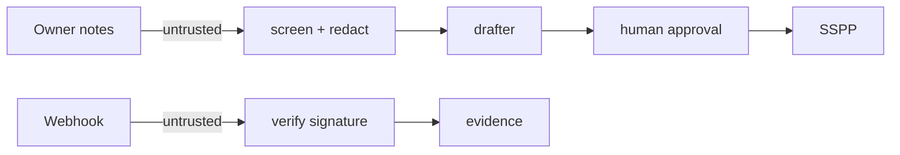

# Threat model

## STRIDE

| Threat | Example here | Control | Test |
|---|---|---|---|
| Spoofing | Forged webhook | HMAC signature, 300 s window, replay cache | `test_webhook_rejections` |
| Tampering | Edited evidence or binder file | SHA-256 hashes, lineage, manifest | `test_evidence_hash_and_lineage`, `test_binder_deterministic_and_verifiable` |
| Repudiation | "I never approved that" | Approver, date and note on every approval; hash-chained audit log | `test_only_approved_text_is_final` |
| Information disclosure | Tenant A reads tenant B | Per-tenant keys, scoped reads | `test_crypto_cross_tenant` |
| Denial of service | Huge webhook body | 413 above size limit | `test_webhook_rejections` |
| Elevation of privilege | Agent approves its own draft | Agents capped at read + draft | `test_agents_only_read_and_draft` |

## OWASP Top 10 for LLM applications (relevant items)

| Risk | Control |
|---|---|
| Prompt injection | Pattern screen blocks the draft |
| Sensitive information disclosure | Redaction before prompt; no training on customer data in config |
| Excessive agency | No tools that write, send or approve |
| Overreliance | Human approval with a note; drafts carry citations and an input hash |
| Supply chain | Pinned dependencies, Dependabot, CodeQL, gitleaks |

