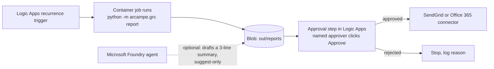

# Deploying the leadership reports (guide, nothing here is deployed)

**What you'll learn:** three ways to run the daily and weekly reports on a schedule, and the extra steps needed
before any real email can go out.

**Read this after:** [docs/learn/09_EXECUTIVE_REPORTING.md](../../docs/learn/09_EXECUTIVE_REPORTING.md)

The repo only writes previews (`out/reports/*.html|eml|pdf|csv`). `reporting.send()` refuses to send unless
**all three** are true: a config with `"enabled": true` and allowed recipient domains, `approved=True` from a
named person, and a transport object you write yourself. Nothing below is created by this repo, and nothing
here costs money until you build it yourself.

## Option 1: cron on a small VM or container

```bash
python -m arcampe.grc schedule --out out      # prints the crontab lines (America/New_York)
```

Copy the lines into `crontab -e`. They only build previews. Someone reviews `out/reports/` before forwarding.

## Option 2: GitHub Actions (previews as an artifact)

Copy [leadership-report.yml](leadership-report.yml) into `.github/workflows/` in your own fork. Reviewers download
the artifact. No secrets are needed.

## Option 3: Microsoft Foundry + Logic Apps + SendGrid (design only)



1. **Recurrence trigger** in Logic Apps (weekdays 07:00 Eastern).
2. **Run the job** (Container Apps job or Functions) that writes the previews to a private blob container.
3. **Approval:** a Logic Apps "Send approval email" action to a named person. Without approval the flow stops.
4. **Send:** the SendGrid (or Office 365 Outlook) connector, with the API key in Key Vault and read by a managed
   identity. Restrict recipients to your own domain, which matches `allowed_domains` in
   [send_config.example.json](send_config.example.json).
5. **Optional Microsoft Foundry agent:** may draft a short summary of the week. It is suggest-only, and its
   output is shown to the approver, never sent directly.

Cost and safety notes: every one of these services can bill. Use a test subscription, add budget alerts, and
keep the approval step. Never put an API key in the repo or in the config file.
